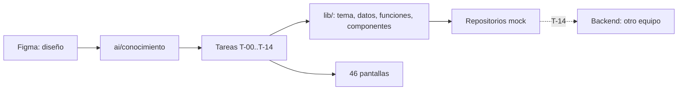

# Grafo de conocimiento · AboGator Frontend

Mapa navegable del proyecto: qué existe, dónde está y con qué se relaciona. **Se actualiza cada vez que se crea, mueve, renombra o elimina algo** (reglas en `ai/conocimiento/06-grafo-de-conocimiento.md`). Si algo de aquí no coincide con la realidad, el grafo está mal y hay que corregirlo.

Última actualización: 2026-11-20 · por Claude Chat · tarea: T-09

## Cómo leerlo
- Cada fila es un **nodo** con un ID único. La columna **Relaciones** son las **aristas**: `→` apunta a otro nodo, con un verbo corto (`usa`, `muestra`, `navega a`, `implementa`, `depende de`, `define`).
- **Estado**: `planeado` · `en curso` · `hecho` (ya mergeado a `develop`) · `obsoleto`.
- **Ruta**: ruta real en el repo. `—` si aún no existe.
- Para encontrar algo: buscar su ID o nombre en este archivo y seguir las aristas.

## Vista general

## 1 · Documentos del flujo (los mantiene Claude Chat)
| ID | Nombre | Ruta | Estado | Relaciones |
|---|---|---|---|---|
| DOC-00 | Proyecto | ai/conocimiento/00-proyecto.md | hecho | → define alcance; → EXT-FIGMA |
| DOC-01 | Flujo de trabajo | ai/conocimiento/01-flujo-de-trabajo.md | hecho | → define ramas y ciclo; → GRAFO |
| DOC-02 | Diseño: tokens | ai/conocimiento/02-diseno-tokens.md | hecho | → define TEMA |
| DOC-03 | Pantallas | ai/conocimiento/03-pantallas.md | hecho | → lista PANT-* |
| DOC-04 | Plan de tareas | ai/conocimiento/04-plan-de-tareas.md | hecho | → lista T-* |
| DOC-05 | Reglas y seguridad | ai/conocimiento/05-reglas-y-seguridad.md | hecho | → aplica a todo el código |
| DOC-06 | Reglas del grafo | ai/conocimiento/06-grafo-de-conocimiento.md | hecho | → define GRAFO |
| DOC-07 | Especificación de componentes | ai/conocimiento/07-componentes.md | hecho | → define COMP-*; ← lo usan T-01 y las tareas de pantallas |
| GRAFO | Este archivo | ai/grafo.md | hecho | ← lo actualizan Claude Chat y Claude Code |
| SIG | Tarea actual (T-09: Buzón de Apelaciones) | ai/siguiente.md | en curso | → apunta a la tarea vigente |
| REP | Reporte | ai/reporte.md | en curso | ← lo escribe Claude Code; → responde a SIG |

## 2 · Externos
| ID | Nombre | Dónde | Relaciones |
|---|---|---|---|
| EXT-FIGMA | Diseño de Figma | fileKey SYNAyUal3xVk4k8SEBEb7f | → fuente de PANT-*, TEMA, COMP-* |
| EXT-BACK | Backend (FastAPI) | repositorio de otros compañeros | ← lo consume REPO-* en T-14 |
| EXT-BD | Base de datos (PostgreSQL) | repositorio de otros compañeros | ← la usa EXT-BACK |
| EXT-ASSETS | Logos, poses de Sarko, íconos y fuentes | Originales de Figma en la computadora del usuario (`Imegenes/Logo-Isotipo/`, fuera de git); copias renombradas en `assets/imagenes/` (FIX-02). Íconos: Lucide. Fuentes: `assets/fuentes/`. Pendiente: reexportar a 3x | → los usan COMP-SARKO, COMP-ICONO, COMP-LOGO y TEMA-TIPO |

## 3 · Tareas
| ID | Rama | Estado | Pantallas / áreas | Depende de |
|---|---|---|---|---|
| T-00 | 00-base-del-proyecto | hecho | proyecto Flutter, TEMA, DATOS, RUTAS | — |
| T-01 | 01-componentes-base | hecho | COMP-*, fuentes locales, íconos, imágenes, plataforma web de desarrollo | T-00 |
| T-02 | 02-bienvenida | hecho | PANT-01..04, COMP-VEREDICTO, token estado/escalar | T-01 |
| FIX-02 | fix/02-imagenes-figma | hecho | imágenes de Figma (logos, Sarko, íconos) y Splash con verde de marca | T-02 |
| T-03 | 03-acceso | hecho | PANT-05, PANT-06 | T-01, T-02 |
| T-04 | 04-inicio | hecho | PANT-07, 07b | T-01, T-03 |
| T-04b | 04b-mapa-e-intro | hecho | PANT-08, 09 | T-04 |
| T-05 | 05-tarjeta-swipe | hecho | PANT-10, 11, 11b, 11c, 13 | T-01 |
| T-06 | 06-veredictos | hecho | PANT-12, 12b, 12c, 14, 14b | T-05 |
| T-06b | 06b-fin-de-sprint | hecho | PANT-19, 19b | T-06 |
| T-07 | 07-evidencia-y-comodines | hecho | PANT-15, 16, 16b, 17, 18 | T-05 |
| T-07b | 07b-comodines | hecho | PANT-10b, 10c (y activación del Amparo, 14b) | T-07 |
| T-08 | 08-vidas-y-offline | hecho | PANT-20, 23 | T-06 |
| T-09 | 09-apelaciones | en curso | PANT-21b, 21 | T-06 |
| T-09b | 09b-juicio-apelacion | planeado | PANT-22, 22b | T-09 |
| T-10 | 10-tienda-perfil-ajustes | planeado | PANT-24, 25, 26, 26b | T-01 |
| T-11 | 11-nivel-jefe | planeado | PANT-27, 28, 28b, 28c, 29, 30 | T-05 |
| T-12 | 12-tablet | planeado | variantes de tablet | T-02..T-11 |
| T-13 | 13-accesibilidad-y-pulido | planeado | todas | T-12 |
| T-14 | 14-integracion-api | planeado | REPO-* → HTTP | EXT-BACK listo |

## 4 · Código (lo mantiene Claude Code)
| ID | Nombre | Ruta | Estado | Relaciones |
|---|---|---|---|---|
| MAIN | Punto de entrada (orientación vertical, ProviderScope) | lib/main.dart | hecho | → arranca APP |
| APP | App y configuración (MaterialApp.router, es_MX, tema claro/oscuro) | lib/app/app.dart | hecho | → usa ENRUTADOR, TEMA, MODO-TEMA, TEXTOS |
| ENRUTADOR | GoRouter (proveedor Riverpod): arranca en `/splash`; `/` redirige al Splash; onboarding, inicio de sesión, registro, Inicio real con el mapa de sprints y la intro **anidados** (la redirección sin sesión cubre los tres), juego real en `/juego/:sprintId` (también redirige sin sesión), marcadores de sprint completado, Startup en quiebra, sin vidas, Examen final, Buzón, Tienda y Perfil, y `/galeria` solo en debug. T-06b: `/juego/:sprintId/completado` y `/juego/:sprintId/quiebra` son las pantallas reales (redirigen sin sesión) T-08: `/sin-vidas` real (`PantallaSinVidas`, parámetro `modulo`, redirige sin sesión); al crearse dispara la sincronización de la cola (al abrir la app). T-09: `/buzon` real (`PantallaBuzon`, redirige sin sesión) con la ruta hija `:apelacionId` (juicio, marcador de T-09b). | lib/app/enrutador.dart | en curso | → usa RUTAS, SESION; → navega a PANT-01..10, PANT-PENDIENTE, PANT-GALERIA; → DEC-RUTAS-ANIDADAS; → muestra CODIGO-PANT-19, CODIGO-PANT-19b; → usa CODIGO-PANT-20, EST-SINCRONIZACION; → usa CODIGO-PANT-21 |
| RUTAS | Constantes de rutas de todas las pantallas; tramos anidados `segmentoMapa` y `segmentoIntro`; ayudantes `mapaSprintsDe`, `introSprintDe`, `juegoDe`, `sprintCompletadoDe`, `startupQuiebraDe` y `crisisJefeDe` T-08: `sinVidasDe(moduloId)`; se quitó `sinConexion` (23 es un estado del juego). T-09: `juicioApelacionDe(id)` (enlace profundo de 21b). | lib/app/rutas.dart | en curso | → nombra PANT-*; ← lo usan ENRUTADOR, MARCO-PRINCIPAL y CODIGO-PANT-10 |
| PANT-PENDIENTE | Marcador temporal de pantallas que llegan en otra tarea: Sin vidas (T-08), Buzón (T-09), Tienda y Perfil (T-10) y Examen final (T-11) T-08: ya no cubre "Sin vidas". T-09: ya no cubre el Buzón; queda el juicio (T-09b). | lib/app/pantalla_pendiente.dart | en curso | ← lo usa ENRUTADOR; → se reemplaza por PANT-19, 19b, 20, 21, 24, 25 y 27 |
| MARCO-PRINCIPAL | Marco compartido de las pantallas con barra inferior (`MarcoPrincipal`: cuerpo, navegación inferior, Buzón fijo y foco ordenado opcional) y `irAPestana` (Mapa vuelve al Inicio) | lib/app/marco_principal.dart | hecho | → usa COMP-NAV, COMP-BUZON, RUTAS; ← lo usan CODIGO-PANT-07 y CODIGO-PANT-08 |
| TEMA | Tema claro/oscuro y tokens | lib/core/tema/ | hecho | ← define DOC-02; → lo usan todos los COMP-* y PANT-* |
| TEMA-TOKENS | 18 tokens de color (ThemeExtension `TokensColor.claro/oscuro`; T-01 agrega borde/control, estado/condicional y foco/anillo; T-02 agrega estado/escalar) | lib/core/tema/tokens_color.dart | hecho | ← define DOC-02, DOC-07; ← verifica TEST-TEMA |
| TEMA-MARCA | Colores de marca (15) y de módulo (5), solo decorativos | lib/core/tema/colores_marca.dart | hecho | ← define DOC-02; → lo usa MOCK-PROG |
| TEMA-TIPO | 11 estilos de texto (`TipografiaBase`, `EstilosTexto`); tracking 0.2 en Botón, Etiqueta y Leyenda; fuentes locales | lib/core/tema/tipografia.dart | hecho | → usa ASSETS-FUENTES; → DEC-FUENTES; ← verifica TEST-TEMA |
| TEMA-APP | Construcción del `ThemeData` a partir de los tokens | lib/core/tema/tema_app.dart | hecho | → usa TEMA-TOKENS, TEMA-TIPO; ← lo usa APP |
| TEMA-EFECTOS | Efectos que no son tokens: sombras (botón, veredicto, tarjeta de caso, héroe, módulo, Buzón, globo), brillo de barra, elipse del héroe, ícono sobre color de módulo, encabezado del módulo (blancos, pista, relleno `#E0A060`, etiqueta al 85 %, fondo oscurecido por contraste), camino (8, guion 2, hueco 15), pulso al 40 %, bases de los nodos, sombra de la tarjeta de caso (0, 16, 20, 22 %), velo del panel de veredicto (#0B1220 al 40 %) y su duración (280 ms), opacidades de la pila (80 % y 50 %), inclinación (14°) y espaciado (3) de los sellos, opacidades y duración con "reducir animaciones"; T-06b: colores del confeti y su duración (1.2 s) T-07: colores del snippet de código (fondo, barra, botones de ventana, textos, línea clave revelada, resaltado #FFE27A al 12 % con borde) y la duración del resaltado. T-07b: subrayado de las palabras trampa (#FFD84D al 65 % en claro y al 35 % en oscuro, grosor 11). T-09: colores de la notificación del sistema (21b). | lib/core/tema/efectos.dart | en curso | → usa UTIL-CONTRASTE; ← lo usan COMP-BOTON, COMP-VEREDICTO, COMP-PROGRESO, COMP-PAGINADOR, COMP-IMPACTO, COMP-HEROE, COMP-MODULO, COMP-BUZON, COMP-ENCABEZADO-MODULO, COMP-NODO-SPRINT, COMP-CAMINO, COMP-GLOBO-SPRINT, COMP-TARJETA-CASO, COMP-PILA, COMP-SELLO, PANT-01, PANT-02..04; → DEC-ENCABEZADO-CONTRASTE, DEC-BASES-NODO; ← lo usa COMP-SNIPPET; ← lo usa COMP-TARJETA-CASO (trampas); ← lo usa COMP-NOTIFICACION |
| TEMA-ICONOS | Catálogo `IconosApp` (45 nombres de Figma → Lucide, más eyeOff) | lib/core/tema/iconos_app.dart | hecho | → usa DEP-LUCIDE; ← lo usan COMP-ICONO y los COMP-* |
| MODO-TEMA | Proveedor del modo claro/oscuro (sigue al sistema; se fuerza en T-10) | lib/core/tema/modo_tema.dart | hecho | ← lo usan APP y PANT-GALERIA; → lo usará PANT-26 |
| TEXTOS | Textos centralizados (componentes, galería, Splash, onboarding, acceso, Inicio con nombres cortos y tramos de módulos, mapa de sprints, intro del sprint con singular/plural, panel de veredicto (títulos, subtítulos, "¿Por qué?", bonus, botones, anuncio y opciones), juego (paso, semántica de la tarjeta, sellos, acciones del lector, comodines, diálogo de salida), validaciones y marcadores); T-06b: textos de 19 y 19b (estadísticas, aviso del buzón por número de falladas, etiqueta y descripciones genéricas de quiebra, "sin resultado") y galería del fin de sprint T-07: tarjeta con evidencia, visor (16, 16b y línea equivocada), tarjeta de dilema y panel de justificación (18), semántica de líneas y opciones seleccionadas, sección de la galería. T-07b: estados y anuncios de los comodines, etiqueta de la Lupa, panel del Abogado. T-08: textos de 20 (tiempo, recuperación, sugerencia del Buzón en singular y plural, semántica por minuto) y de 23 (avisos de conexión, respuestas guardadas, interruptor de depuración); se quitó `sinVidasPendiente`. T-09: Buzón (recompensa en singular y plural, plazos hoy/mañana/en N días, avisos, semántica de filas y lista, vacío, error) y notificación 21b; se quitó `pendienteBuzon`. | lib/core/textos/textos.dart | en curso | → los usan las pantallas, VALIDADORES, LOGICA-INICIO, LOGICA-MAPA y MOCK-* |
| UTIL | Extensiones de contexto (`context.tokens`, `context.estilos`) | lib/core/utilidades/extensiones_contexto.dart | hecho | → usa TEMA-TOKENS, TEMA-TIPO |
| UTIL-CONTRASTE | Cálculo de contraste WCAG 2.1 | lib/core/utilidades/contraste.dart | hecho | ← lo usa TEST-TEMA |
| RECURSOS | Rutas de las imágenes (`ImagenesApp`): `logo(FormaLogo, TonoLogo)`, piezas base, poses de Sarko e íconos de app; enums `FormaLogo` (con medidas en px) y `TonoLogo` | lib/core/recursos/imagenes_app.dart | hecho | → apunta a ASSETS-LOGOS, ASSETS-SARKO, ASSETS-ICONO-APP; ← lo usan COMP-SARKO, COMP-LOGO, CODIGO-PANT-01, PANT-GALERIA |
| MOD | Modelos de datos (Usuario, Modulo, Sprint, Tarjeta, EstadoStartup, Vidas, Apelacion, ArticuloTienda). Desde T-04b, `Sprint` tiene objetivo, tarjetas normales / con evidencia / dilemas, monedas máximas, minutos estimados y estrellas; `numeroTarjetas` es la suma; T-05 agrega `tituloIntro` a `Sprint` y `etiquetaCaso`, `personaje` y `rol` a `Tarjeta`; T-06 agrega `ImpactoTarjeta` (acierto, fallo y parcial), `MicroPregunta` y `explicacionFallo`/`explicacionParcial`. T-06b: `Sprint` con `mensajeCompletado`, `mensajeQuiebra` y `copiar`; `Modulo.copiar`; `EstadoStartup` con igualdad; enum `CausaQuiebra` T-07: `EvidenciaTarjeta` (archivo, líneas, `lineasClave` desde 1, mensajes de acierto y fallo) reemplaza al `String? evidencia`, y `Justificacion` (3 opciones, índice correcto) en `Tarjeta.justificacion`. T-07b: `Tarjeta` con `palabrasTrampa`, `traduccionLegal`, `normas` e `iniciales` (todos opcionales), y `aplicaLupa`/`aplicaAbogado`. T-08: `Vidas.faltaParaProxima` (Duration, lo que dice el servidor) reemplaza a `proximaEn`; `RespuestaPendiente` (UUID del cliente, veredicto, justificación, evidencia, UTC, intentos) con conversión a fila de SQLite. T-09: `Apelacion` con `moduloId`, `titulo` y `tema` (sin `resumen`); `NuevaApelacion`; `BuzonApelaciones` (hora del servidor, orden, `deHoy`, `total`, días calendario UTC); `Tarjeta.titulo`, `tema` y `tituloCorto`. | lib/datos/modelos/ | en curso | → los usan REPO-*; ← los usan COMP-SNIPPET, COMP-PANEL-EVIDENCIA y COMP-PANEL-JUSTIFICACION; ← los usan LOGICA-COMODINES, COMP-PANEL-ABOGADO; ← los usan COLA-RESPUESTAS, REPO-RESPUESTAS |
| REPO-* | Interfaces de repositorio (auth, progreso, tarjetas, vidas, apelaciones, tienda) | lib/datos/repositorios/ | hecho | → implementan MOCK-*; en T-14 → HTTP |
| REPO-AUTH | Autenticación (inicio de sesión, registro con dos consentimientos) | lib/datos/repositorios/repositorio_autenticacion.dart | hecho | → usa MOD; ← implementa MOCK-AUTH; → servirá a PANT-05, PANT-06 |
| REPO-PROG | Progreso: módulos, sprints y estado de la Startup; T-06b: `registrarSprintCompletado` (estrellas máximas, siguiente sprint en curso, estado final de la Startup) | lib/datos/repositorios/repositorio_progreso.dart | hecho | → usa MOD; ← implementa MOCK-PROG; → servirá a PANT-07..09 |
| REPO-TARJ | Tarjetas de un sprint T-09: `obtenerTarjeta(id)` (para T-09b). | lib/datos/repositorios/repositorio_tarjetas.dart | en curso | → usa MOD; ← implementa MOCK-TARJ; → servirá a PANT-10..19b |
| REPO-VIDAS | Vidas (regeneración del servidor); T-06b: `guardarVidas` T-08: devuelve `faltaParaProxima`. | lib/datos/repositorios/repositorio_vidas.dart | hecho | → usa MOD; ← implementa MOCK-VIDAS; → servirá a PANT-20 |
| REPO-APEL | Apelaciones pendientes T-09: `obtenerBuzon()` reemplaza a `obtenerApelacionesPendientes()`; `registrarFallos` (día 3 a +3 días, sin duplicar por tarjeta). | lib/datos/repositorios/repositorio_apelaciones.dart | en curso | → usa MOD; ← implementa MOCK-APEL; → servirá a PANT-21..22b; ← lo usan EST-JUEGO y CODIGO-PANT-21 |
| REPO-TIENDA | Tienda de comodines y monedas; T-06b: `sumarMonedas` T-07b: `obtenerComodines()` (cantidades por comodín) y `consumirComodin(c)` (resta 1, nunca baja de 0). La compra llega en T-10. | lib/datos/repositorios/repositorio_tienda.dart | hecho | → usa MOD; ← implementa MOCK-TIENDA; → servirá a PANT-24; ← lo usa EST-JUEGO (comodines) |
| REPO-ONBOARDING | Estado "onboarding visto" (`fueVisto`, `marcarVisto`) T-08: SQLite en el dispositivo y memoria en web y pruebas. | lib/datos/repositorios/repositorio_onboarding.dart | hecho | ← implementa MEM-ONBOARDING; ← lo usa FLUJO-BIENVENIDA; en T-08 → SQLite; ← implementa ONBOARDING-SQLITE |
| PROV-REPO | Proveedores Riverpod: único lugar donde se elige mock o HTTP (T-02 agrega el de onboarding) T-08: `usarBaseLocal` (no en web ni en `flutter test`), `baseLocalProvider`, `repositorioColaRespuestasProvider` y onboarding (SQLite o memoria), `repositorioRespuestasProvider` y `servicioConexionProvider`. | lib/datos/repositorios/proveedores_repositorios.dart | hecho | → expone REPO-*; → hoy usa MOCK-* y MEM-ONBOARDING; en T-14 → HTTP; → usa BASE-LOCAL, COLA-RESPUESTAS, REPO-RESPUESTAS, SERVICIO-CONEXION |
| MOCK-* | Repositorios simulados; desde T-04b `esperar` no crea temporizador con espera cero | lib/datos/mocks/ | hecho | → implementan REPO-* |
| MOCK-AUTH | Autenticación simulada: usuario demo Ana López (Dev, nivel 4, racha 7); rechaza registro sin ambos consentimientos y la contraseña `incorrecta` | lib/datos/mocks/mock_autenticacion.dart | hecho | → implementa REPO-AUTH; → usa TEXTOS |
| MOCK-PROG | 5 módulos de 5 sprints más el Examen final (6 nodos); módulo 1 como Figma (Datos personales y Consentimiento completados con 3 estrellas, Aviso de privacidad en curso con 10 tarjetas y título largo "Aviso de privacidad en el MVP", Derechos ARCO, Brechas de seguridad, Auditoría de inversores); los demás bloqueados; objetivos en minúscula (la intro antepone "Objetivo: "); estado de la Startup 70/60/50/25 como en Figma; T-06b: mensajes de completado y quiebra por sprint del módulo 1; guarda en memoria (por instancia) los sprints completados y el estado de la Startup (`estadoInicial` 70/60/50/25) | lib/datos/mocks/mock_progreso.dart | hecho | → implementa REPO-PROG; → usa TEMA-MARCA |
| MOCK-TARJ | Tarjetas de ejemplo con etiqueta de caso, personaje y rol: `spr-1-3` con 10 (6 normales, 3 con evidencia y 1 de justificación), `spr-1-2` y `spr-2-1` con 2 (incluye "Librería GPL en app cerrada" con los impactos, la micro-pregunta y los textos de Figma); en `spr-1-3` cada tarjeta tiene impactos de acierto, fallo y parcial, y 4 de las 10 llevan micro-pregunta. T-06b: los 5 sprints del módulo 1 completos (8, 8, 10, 8 y 8 tarjetas con su composición, impactos y 3 o 4 micro-preguntas); la GPL-3.0 pasa a ser la tarjeta 5 de `spr-1-3` y `spr-2-1` queda con la tarjeta MIT; sin plazos ni montos legales con cifra (revisión de T-06b) T-07: evidencias migradas a `EvidenciaTarjeta` y justificación en los 5 dilemas; sin micro-pregunta en las tarjetas de evidencia y de dilema (2 por sprint en las normales). `spr-1-3`: la tarjeta 6 es `registro_form.dart` (Figma 15 y 16b; los menores pasan a la 8 en lugar de las cookies) y la 10 el dilema de contraseñas (Figma 17 y 18; sustituye al del inversionista). `spr-1-5`: la evidencia pasa de la bitácora (correcta Legal) a las contraseñas en texto plano. T-07b: las 42 tarjetas del módulo 1 con palabras trampa (2 a 4, tal cual del texto), traducción legal y normas por nombre (solo las 2 de Figma llevan artículo o sección); iniciales de dos letras ("QA", "CL", "MK", "CT", "CE", "SP"). T-09: `titulo` (≤ 45) y `tema` en las 42 tarjetas del módulo 1 y la MIT; `obtenerTarjeta`. | lib/datos/mocks/mock_tarjetas.dart | en curso | → implementa REPO-TARJ |
| MOCK-VIDAS | Vidas (5 de 5 por defecto, cantidad configurable) con hora del servidor simulada si faltan; T-06b: guarda las vidas en memoria (0–5) con `guardarVidas` T-08: imita al servidor con reloj inyectable: programa la regeneración a 2 h al bajar de 5, aplica las vencidas sin pasar de 5 y da `faltaParaProxima`. | lib/datos/mocks/mock_vidas.dart | hecho | → implementa REPO-VIDAS |
| BASE-LOCAL | `BaseLocal`: base SQLite `abogator.db` (versión 1) con `respuestas_pendientes` y `ajustes`; se abre en la primera operación; fábrica y ruta inyectables para las pruebas | lib/datos/local/base_local.dart | hecho | ← la usan COLA-RESPUESTAS y ONBOARDING-SQLITE; ← verifica TEST-BASE-LOCAL |
| COLA-RESPUESTAS | `ColaRespuestas` (agregar idempotente por id, pendientes en orden, cantidad, marcar enviadas, intentos fallidos) con `ColaRespuestasSqlite` y `ColaRespuestasEnMemoria` | lib/datos/repositorios/cola_respuestas.dart, lib/datos/local/cola_respuestas_sqlite.dart, lib/datos/mocks/cola_respuestas_en_memoria.dart | hecho | → usa MOD, BASE-LOCAL; ← la usan PROV-REPO y SINCRONIZADOR |
| ONBOARDING-SQLITE | `OnboardingSqlite`: `onboarding_visto = 1` en la tabla `ajustes` | lib/datos/local/onboarding_sqlite.dart | hecho | → implementa REPO-ONBOARDING; → usa BASE-LOCAL |
| REPO-RESPUESTAS | `RepositorioRespuestas.enviarRespuestas` (ids aceptados) y `MockRespuestas` (sin duplicar por id, `recibidas`, puede fallar) | lib/datos/repositorios/repositorio_respuestas.dart, lib/datos/mocks/mock_respuestas.dart | hecho | ← lo usa SINCRONIZADOR; → en T-14 será HTTP |
| SINCRONIZADOR | `SincronizadorRespuestas`: envía la cola y borra solo lo aceptado; si falla suma intentos y no pierde nada; no corre dos veces a la vez (deja pedida una pasada más) | lib/datos/sincronizacion/sincronizador_respuestas.dart | hecho | → usa COLA-RESPUESTAS, REPO-RESPUESTAS; ← lo usa EST-SINCRONIZACION |
| SERVICIO-CONEXION | `ServicioConexion` (`EstadoConexion`, `cambios`) y `ConexionSimulada` (arranca en línea, `establecer`) | lib/datos/sincronizacion/servicio_conexion.dart | hecho | ← lo usan PROV-REPO y EST-SINCRONIZACION; → en T-14, detección real |
| EST-SINCRONIZACION | `conexionProvider` y `respuestasPendientesProvider` (cantidad en cola; agrega, sincroniza al guardar en línea, al volver la conexión y al abrir la app) | lib/datos/sincronizacion/estado_sincronizacion.dart | hecho | → usa SERVICIO-CONEXION, SINCRONIZADOR, PROV-REPO; ← lo usan EST-JUEGO, CODIGO-PANT-10, ENRUTADOR |
| UTIL-UUID | `generarUuidV4()` con `Random.secure()` (versión 4, variante RFC 4122) | lib/core/utilidades/uuid.dart | hecho | ← lo usa EST-JUEGO |
| UTIL-CRONOMETRO | `Cronometro` (reloj monótono) y `CronometroSistema` (Stopwatch) | lib/core/utilidades/cronometro.dart | hecho | ← lo usan COMP-CUENTA-REGRESIVA y CODIGO-PANT-20 |
| CODIGO-PANT-20 | Pantalla 20 Sin vidas: cerrar, corazones, Sarko triste, título, cuenta regresiva del servidor, nota, sugerencia del Buzón (N real; oculta con 0) y "Volver al mapa"; al recuperar una vida, corazones llenos, "¡Recuperaste una vida!" y anuncio T-09: la sugerencia cuenta las de hoy (`deHoy`). | lib/funciones/vidas/pantalla_sin_vidas.dart | en curso | → implementa PANT-20; → usa COMP-CUENTA-REGRESIVA, COMP-ILUSTRACION-SARKO, COMP-CORAZON, PIEZAS-FIN-SPRINT, REPO-VIDAS, REPO-APEL; ← la usan ENRUTADOR y CODIGO-PANT-10 |
| CODIGO-PANT-21 | Pantalla 21 Buzón de Apelaciones (pestaña Buzón, sin botón flotante): título con foco, Sarko alegre detrás, recompensa de hoy, lista con franja del módulo y plazos del servidor; las de hoy abren el juicio y las futuras avisan; "Iniciar apelaciones de hoy" fijo (deshabilitado sin las de hoy); vacío, esqueleto y error | lib/funciones/apelaciones/pantalla_buzon.dart | en curso | → implementa PANT-21; → usa REPO-APEL, REPO-PROG, MARCO-PRINCIPAL, COMP-FILA-APELACION; ← la usa ENRUTADOR; ← verifica TEST-BUZON |
| MOCK-APEL | Seis apelaciones pendientes (como el contador de Figma) T-09: estado en memoria por instancia con reloj inyectable; semilla de 6 relativa al reloj (2 de hoy como Figma, mañana, en 2 días y dos de día 14). | lib/datos/mocks/mock_apelaciones.dart | en curso | → implementa REPO-APEL |
| MOCK-TIENDA | Los tres comodines y 240 monedas; T-06b: suma monedas en memoria (`sumarMonedas`) T-07b: comodines en memoria por instancia (lupa 2, abogado 1, amparo 1, como Figma) y descripciones que dicen lo que hace cada uno. | lib/datos/mocks/mock_tienda.dart | hecho | → implementa REPO-TIENDA |
| MEM-ONBOARDING | Implementación en memoria del estado "onboarding visto" (dura mientras la app está abierta) | lib/datos/mocks/onboarding_en_memoria.dart | hecho | → implementa REPO-ONBOARDING |
| PANT-PRUEBA | Pantalla temporal "Tema de prueba" (eliminada en T-01; la reemplaza PANT-GALERIA) | — | obsoleto | → reemplazada por PANT-GALERIA |
| PANT-GALERIA | Galería temporal de componentes (todos los tipos y estados, claro/oscuro; 20 logos, 4 poses, componentes de acceso, del Inicio y del mapa: 2 encabezados, 4 nodos y estrellas parciales, globo y filas de detalle; y del juego: barra, tarjeta de caso con pila, 4 sellos, acciones y comodines; y los 5 paneles de veredicto); ruta `/galeria` solo en debug; se elimina con las pantallas reales; T-06b: sección "Componentes del fin de sprint" (confeti, 3 estrellas, estadísticas, 2 avisos y 2 etiquetas de quiebra) T-07: sección "Evidencia y dilema" (tarjetas por tipo, snippets, 3 visores, opciones en modo selección y panel 18). T-07b: barra en sus 3 estados y apagada, etiqueta de la Lupa, tarjeta con trampas y panel del Abogado. T-08: sección "Vidas y conexión" (cuenta regresiva, sugerencia del Buzón, avisos de conexión, respuestas guardadas e interruptor). T-09: sección "Buzón de Apelaciones" (recompensa 2/1/0, filas de hoy y futuras, dos notificaciones). | lib/funciones/bienvenida/galeria_componentes.dart | en curso | → usa COMP-*, RECURSOS, MODO-TEMA, TEXTOS, TEMA-ICONOS; ← verifica TEST-GALERIA; → muestra COMP-CONFETI, COMP-ESTRELLAS-SPRINT, COMP-ESTADISTICAS, COMP-AVISO, COMP-ETIQUETA-QUIEBRA; → muestra COMP-SNIPPET, COMP-PANEL-EVIDENCIA, COMP-PANEL-JUSTIFICACION; → muestra COMP-ETIQUETA-LUPA, COMP-PANEL-ABOGADO; → muestra COMP-CUENTA-REGRESIVA, COMP-AVISO-CONEXION, COMP-PENDIENTES; → muestra COMP-FILA-APELACION, COMP-NOTIFICACION |
| FLUJO-BIENVENIDA | Reglas del flujo Splash → Onboarding → Inicio de sesión (destino tras el Splash, terminar onboarding) | lib/funciones/bienvenida/flujo_bienvenida.dart | hecho | → usa REPO-ONBOARDING, RUTAS; ← lo usan PANT-01 y PANT-02..04 |
| CODIGO-PANT-01 | Pantalla 01 Splash (logo vertical sobre verde real a 323.7×187.9, lema, puntos de carga, avance a los 2 s; colores de marca fijos en ambos modos) | lib/funciones/bienvenida/pantalla_splash.dart | hecho | → implementa PANT-01; → usa COMP-LOGO, RECURSOS, FLUJO-BIENVENIDA, TEMA-EFECTOS; → DEC-SPLASH-MARCA |
| CODIGO-PANT-02..04 | Pantallas 02, 03, 03b y 04 Onboarding (un `PageView`, Omitir, paginador y botón) | lib/funciones/bienvenida/pantalla_onboarding.dart | hecho | → implementa PANT-02, PANT-03, PANT-03b, PANT-04; → usa COMP-BOTON, COMP-PAGINADOR, COMP-FOCO, FLUJO-BIENVENIDA, ILUS-ONBOARDING |
| ILUS-ONBOARDING | Ilustraciones decorativas del onboarding (lienzo 390×400, miniatura de tarjeta de caso) | lib/funciones/bienvenida/ilustraciones_onboarding.dart | hecho | → usa COMP-SARKO, COMP-VEREDICTO, COMP-INDICADORES, COMP-CORAZON, COMP-CHIP |
| FUNC | Carpetas por área (bienvenida, acceso, inicio, mapa, juego, apelaciones, tienda, perfil, jefe) | lib/funciones/ | hecho | → contienen PANT-* (bienvenida, acceso, inicio, mapa y juego ya implementadas) |
| VALIDADORES | Validaciones puras de acceso: nombre (2–60), correo (formato, ≤ 254), contraseña de inicio (no vacía) y de registro (≥ 8 con un número), perfil y consentimientos | lib/funciones/acceso/validadores.dart | hecho | → usa TEXTOS; ← lo usan EST-INICIO-SESION y EST-REGISTRO; ← verifica TEST-ACCESO |
| SESION | Proveedor de sesión (`sesionProvider`, `Usuario?`); nunca guarda credenciales | lib/funciones/acceso/sesion.dart | hecho | → usa MOD; ← lo llenan EST-INICIO-SESION y EST-REGISTRO; ← lo usan CODIGO-PANT-07 y ENRUTADOR |
| EST-INICIO-SESION | Estado y envío del inicio de sesión (errores por campo, error del repositorio, cargando); no guarda la contraseña | lib/funciones/acceso/estado_inicio_sesion.dart | hecho | → usa REPO-AUTH (vía PROV-REPO), VALIDADORES, SESION |
| EST-REGISTRO | Estado y envío del registro (perfil sin selección inicial, dos consentimientos independientes, errores por campo, primer error para el foco) | lib/funciones/acceso/estado_registro.dart | hecho | → usa REPO-AUTH (vía PROV-REPO), VALIDADORES, SESION |
| AVISO-ERROR | Error general anunciado (`AvisoError`) y aviso breve no bloqueante (`mostrarAvisoBreve`) | lib/funciones/acceso/aviso_error.dart | hecho | ← lo usan CODIGO-PANT-05 y CODIGO-PANT-06 |
| CODIGO-PANT-05 | Pantalla 05 Inicio de sesión | lib/funciones/acceso/pantalla_inicio_sesion.dart | hecho | → implementa PANT-05; → usa EST-INICIO-SESION, COMP-LOGO, COMP-SARKO, COMP-CAMPO, COMP-ENLACE, COMP-BOTON, AVISO-ERROR |
| CODIGO-PANT-06 | Pantalla 06 Registro | lib/funciones/acceso/pantalla_registro.dart | hecho | → implementa PANT-06; → usa EST-REGISTRO, COMP-ATRAS, COMP-CHIP-SEL, COMP-CAMPO, COMP-CASILLA, COMP-ENLACE, COMP-BOTON, AVISO-ERROR |
| LOGICA-INICIO | Reglas puras del Inicio: iniciales, primer nombre, perfil corto, estado de módulo, sprints normales y total sin el Examen final, completados, módulo/sprint actual, nombre corto, tramo e ícono por número; reto diario fijo | lib/funciones/inicio/logica_inicio.dart | hecho | → usa MOD, TEXTOS, TEMA-ICONOS, COMP-MODULO (enum `EstadoModulo`); ← lo usa LOGICA-MAPA; ← verifica TEST-INICIO |
| EST-INICIO | Carga en paralelo de módulos, monedas, vidas y apelaciones pendientes (`datosInicioProvider`); reintento con `invalidate` T-09: el botón Buzón muestra `total` del Buzón. | lib/funciones/inicio/estado_inicio.dart | en curso | → usa REPO-PROG, REPO-TIENDA, REPO-VIDAS, REPO-APEL (vía PROV-REPO) |
| CODIGO-PANT-07 | Pantalla 07 Inicio (07b por tema): encabezado (los chips bajan a otra fila si el saludo no cabe, D6 de T-04b), héroe, reto, módulos; Buzón y pestañas con MARCO-PRINCIPAL; esqueleto, error con reintento | lib/funciones/inicio/pantalla_inicio.dart | hecho | → implementa PANT-07, PANT-07b; → usa EST-INICIO, LOGICA-INICIO, SESION, MARCO-PRINCIPAL, COMP-MENSAJE, COMP-AVATAR, COMP-CHIP, COMP-HEROE, COMP-RETO, COMP-MODULO |
| LOGICA-MAPA | Reglas puras del mapa y la intro: zigzag 50/28/50/72 %, lado de la etiqueta, sprint actual, número sin el Examen final, Examen disponible solo con todo completado, qué nodos abren, tipo de nodo, semántica con estrellas, búsqueda por id y desglose de tarjetas | lib/funciones/mapa/logica_mapa.dart | hecho | → usa MOD, TEXTOS, LOGICA-INICIO, COMP-NODO-SPRINT (enum `TipoNodoSprint`); ← verifica TEST-MAPA |
| EST-MAPA | Carga en paralelo de módulos, vidas y apelaciones pendientes y elige el módulo (`datosModuloProvider`, por id); reintento con `invalidate` T-09: el botón Buzón muestra `total` del Buzón. | lib/funciones/mapa/estado_mapa.dart | en curso | → usa REPO-PROG, REPO-VIDAS, REPO-APEL (vía PROV-REPO), LOGICA-MAPA; ← lo usan CODIGO-PANT-08 y CODIGO-PANT-09 |
| CODIGO-PANT-08 | Pantalla 08 Mapa de sprints: encabezado fijo, mapa desplazable con nodos, camino medido tras el diseño, etiquetas, globo y Sarko; desplazamiento inicial al sprint actual; foco y lectura ordenados; esqueleto, error con reintento y módulo no encontrado | lib/funciones/mapa/pantalla_mapa_sprints.dart | hecho | → implementa PANT-08; → usa EST-MAPA, LOGICA-MAPA, LOGICA-INICIO, MARCO-PRINCIPAL, COMP-ENCABEZADO-MODULO, COMP-NODO-SPRINT, COMP-CAMINO, COMP-GLOBO-SPRINT, COMP-SARKO, COMP-MENSAJE; → navega a PANT-09, PANT-PENDIENTE (Examen final) |
| CODIGO-PANT-09 | Pantalla 09 Intro del sprint: Cerrar, vidas, Sarko sobre elipse fondo/destacado, etiqueta, título largo (`tituloIntro`), objetivo, tarjeta de detalles y "Comenzar sprint" fijo abajo; aviso y botón deshabilitado si está bloqueado; esqueleto, error y no encontrado; T-06b: "Comenzar sprint" reinicia el juego del sprint (`reiniciarJuego`) | lib/funciones/mapa/pantalla_intro_sprint.dart | hecho | → implementa PANT-09; → usa EST-MAPA, LOGICA-MAPA, COMP-CHIP, COMP-SARKO, COMP-FILA-DETALLE, COMP-BOTON, COMP-CERRAR, COMP-MENSAJE; → navega a PANT-08, PANT-10; → usa EST-JUEGO |
| LOGICA-SWIPE | Reglas puras del gesto: eje a los 12 dp, umbrales (28 % del ancho y 80 dp), lanzamiento de 800 dp/s, progreso 0–1, inclinación con tope de 12° (a la mitad del umbral), dirección → veredicto, posición de la previsualización y destino del vuelo | lib/funciones/juego/logica_swipe.dart | hecho | → usa MOD (Veredicto); ← lo usa MAZO-SWIPE; ← verifica TEST-JUEGO |
| EST-JUEGO | `datosJuegoProvider` (por sprint): vidas primero (con 0 no carga el juego), luego tarjetas, estado de la Startup y módulos (número de sprint y color); sprint inexistente = sin tarjetas. `juegoProvider` (`JuegoNotifier`): califica con LOGICA-VEREDICTO y lleva índice (avanza al cerrar el panel), respuestas, estado de la Startup, vidas, XP, monedas, resultados (con bonus), falladas, panel pendiente (`PanelPendiente`, `FasePanel`) y Amparo activo; `elegirOpcion`, `saltarBonus` y `cerrarPanel` (devuelve el destino). Estado local de la sesión del sprint (no se guarda hasta T-14); comodines fijos (`ComodinesJuego`). T-06b: `juegoProvider` se mantiene vivo (`keepAlive`) entre juego, 19 y 19b; guarda `estadoInicial`, `totalTarjetas`, `fin` y `guardado`; `guardarResultado` (completado: progreso, vidas y monedas; quiebra o sin vidas: solo vidas); `reiniciarJuego` lo descarta junto con sus datos T-07: `evidenciaMarcada` (id → acertó) y `lineasMarcadas`; `marcarEvidencia` (una sola vez); `responder(…, justificacion:)` da el bonus de evidencia (+5 XP) o de justificación (+5 XP y monedas dobles) y abre el panel en Bonus; la micro-pregunta solo si no hubo bonus. T-07b: `datosJuegoProvider` carga los comodines de la tienda (se quitó `ComodinesJuego`); `EstadoJuego.comodines`, `lupaUsada` y `abogadoUsado`; `usarLupa`, `consultarAbogado` y `alternarAmparo`; el gasto se guarda con `consumirComodin` al usarlo (el Amparo, al absorber el error). T-08: con 0 vidas resuelve módulo y sprint (para volver desde 20); `responder` guarda cada respuesta en la cola con UUID y sincroniza sin esperar. T-09: `guardarResultado` manda las falladas al Buzón en los tres finales (una vez) y refresca Inicio, mapa y "Sin vidas"; salir a la mitad no registra. | lib/funciones/juego/estado_juego.dart | en curso | → usa REPO-VIDAS, REPO-TARJ, REPO-PROG (vía PROV-REPO), LOGICA-MAPA; ← lo usa CODIGO-PANT-10; → usa LOGICA-VEREDICTO; → usa LOGICA-FIN-SPRINT, REPO-TIENDA; ← lo usan CODIGO-PANT-19, CODIGO-PANT-19b, CODIGO-PANT-09; → usa LOGICA-COMODINES, REPO-TIENDA; → usa EST-SINCRONIZACION; → usa REPO-APEL |
| MAZO-SWIPE | `MazoSwipe`: pila, tarjeta que se arrastra (reconocedor que gana la arena al tocar, para que la pantalla desplazable no robe el gesto), sellos en las posiciones de Figma, vuelo (280 ms, hasta 24°), regreso con resorte (250 ms), entrada desde la pila; al terminar el vuelo oculta sello y tinte hasta la siguiente tarjeta; `previsualizar`, `cancelarPrevia` y `confirmar` para teclado y botones; semántica con 4 acciones personalizadas y región en vivo; sin animaciones con "reducir animaciones" T-07: `alInspeccionar` (soltar sin mover la tarjeta, ≤ 8 dp, abre el visor) y la acción del lector "Inspeccionar evidencia". | lib/funciones/juego/mazo_swipe.dart | hecho | → usa LOGICA-SWIPE, COMP-PILA, COMP-SELLO; ← lo usa CODIGO-PANT-10 |
| CODIGO-PANT-10 | Pantalla 10 Juego (11, 11b, 11c y 13 son sus estados de arrastre): barra de juego, indicadores (bloque enfocable), zona de la tarjeta que se estira o encoge, acciones y comodines (bloque enfocable); tinte de pantalla completa detrás; teclado (flechas, Enter, Esc); pantalla desplazable si no cabe; Salir con confirmación; esqueleto, error con reintento, sin tarjetas y sin vidas; al confirmar abre el panel de veredicto (modal sin descarte, velo, 280 ms, vibración por tipo), muestra vidas e indicadores actualizados con sus cambios y, al cerrarlo, va a quiebra, sin vidas, sprint completado o la siguiente tarjeta; T-06b: al terminar guarda el resultado antes de ir a 19, 19b o sin vidas T-07: visor de evidencia descartable (atrás, Esc, fuera; el foco vuelve al botón de evidencia) y, en los dilemas, el panel de justificación sin descarte **antes** de calificar; la etiqueta de la tarjeta dice su tipo. T-07b: barra de comodines interactiva (deshabilitada con cualquier panel abierto), Lupa con trampas y etiqueta, panel del Abogado descartable (foco de vuelta a la píldora), Amparo armable; anuncios de cantidad. T-08: sin vidas lleva a 20 (`sinVidasDe` del módulo); estado 23 sin conexión: aviso sobre la tarjeta (y "restablecida" unos 3 s), respuestas guardadas en lugar de los comodines, interruptor de depuración. | lib/funciones/juego/pantalla_juego.dart | hecho | → implementa PANT-10, PANT-11, PANT-11b, PANT-11c, PANT-13, PANT-26b; → usa EST-JUEGO, MAZO-SWIPE, COMP-BARRA-JUEGO, COMP-TARJETA-CASO, COMP-TINTE, COMP-ACCIONES, COMP-COMODINES, COMP-INDICADORES, COMP-MENSAJE, LOGICA-INICIO; → navega a PANT-PENDIENTE (sin vidas); → implementa PANT-12, PANT-12b, PANT-12c, PANT-14, PANT-14b; → usa COMP-PANEL-VEREDICTO, COMP-BLOQUE-LECTURA, LOGICA-VEREDICTO; → navega a CODIGO-PANT-19, CODIGO-PANT-19b; → implementa PANT-15, PANT-16, PANT-16b, PANT-17, PANT-18; → usa COMP-PANEL-EVIDENCIA, COMP-PANEL-JUSTIFICACION; → implementa PANT-10b, PANT-10c; → usa LOGICA-COMODINES, COMP-ETIQUETA-LUPA, COMP-PANEL-ABOGADO; → implementa PANT-23; → usa COMP-AVISO-CONEXION, COMP-PENDIENTES, COMP-INTERRUPTOR-DEBUG, EST-SINCRONIZACION, CODIGO-PANT-20 |
| LOGICA-VEREDICTO | Reglas puras de calificación: correcto (+10 XP, +5 monedas), bonus (+5 XP), parcial solo con Escalar (+3 XP, sin perder vida), incorrecto (−1 vida), Amparo (sin perder vida, Riesgo legal +5 menos); aplicar impacto con límites 0–100; quiebra (Riesgo 100 o Presupuesto 0); destino con prioridad quiebra → sin vidas → última → siguiente; explicación por resultado T-07: `aciertaEvidencia` (incluye alguna línea clave), `bonusEvidencia`, `bonusJustificacion` (solo con el veredicto correcto) y `conBonus(monedasDobles:)`. | lib/funciones/juego/logica_veredicto.dart | hecho | → usa MOD (Tarjeta, ImpactoTarjeta, MicroPregunta, EstadoStartup); ← lo usan EST-JUEGO y CODIGO-PANT-10; ← verifica TEST-VEREDICTO |
| LOGICA-COMODINES | Reglas puras de los comodines: restar sin bajar de 0, cuándo se puede usar la Lupa (una vez por tarjeta) y el Abogado (gasta la primera vez), estado de cada píldora y si es tocable (nada con un panel abierto ni en el Examen) | lib/funciones/juego/logica_comodines.dart | hecho | → usa MOD, EST-JUEGO, COMP-COMODINES (enum); ← lo usan EST-JUEGO y CODIGO-PANT-10; ← verifica TEST-COMODINES |
| LOGICA-FIN-SPRINT | Reglas puras del fin de sprint: aciertos (correctas con o sin bonus) y falladas (incorrectas y Amparo; el parcial no cuenta en ninguno), estrellas (≥ 90 % = 3, ≥ 60 % = 2, si no 1; 8/10 da 2, como en Figma 19), cambios respecto al inicio, aviso del buzón (1, 2, 3 o más), causa de la quiebra (manda el Riesgo legal) y descripción de quiebra (del sprint o genérica) | lib/funciones/juego/logica_fin_sprint.dart | hecho | → usa MOD, TEXTOS, COMP-INDICADORES (IndicadorStartup); ← lo usan EST-JUEGO, CODIGO-PANT-19, CODIGO-PANT-19b; ← verifica TEST-FIN-SPRINT |
| PIEZAS-FIN-SPRINT | Piezas de 19 y 19b: `IlustracionFinSprint` (círculo y Sarko decorativo), `TituloFinSprint` (anunciado, con foco inicial sin anillo), `ElementoOrdenado` (orden de lectura y de foco) y `ColumnaFinSprint` (desplazable, botones al final, márgenes 24 y 36) T-08: `IlustracionFinSprint` pasó a COMP-ILUSTRACION-SARKO (compartida con 20). | lib/funciones/juego/piezas_fin_sprint.dart | hecho | → usa COMP-SARKO, COMP-BLOQUE-LECTURA; ← lo usan CODIGO-PANT-19, CODIGO-PANT-19b; ← las usa CODIGO-PANT-20 |
| CODIGO-PANT-19 | Pantalla 19 Sprint completado: confeti, Sarko alegre sobre `fondo/destacado`, estrellas, título y subtítulo del sprint, estadísticas, estado final con cambios, aviso del buzón, "Continuar al mapa" y "Repasar mis fallos" (sin falladas no hay aviso ni Repasar); conserva el último resultado mostrado; sin sprint terminado muestra un mensaje con regreso al mapa T-08: usa COMP-ILUSTRACION-SARKO. | lib/funciones/juego/pantalla_sprint_completado.dart | hecho | → implementa PANT-19; → usa EST-JUEGO, LOGICA-FIN-SPRINT, PIEZAS-FIN-SPRINT, COMP-CONFETI, COMP-ESTRELLAS-SPRINT, COMP-ESTADISTICAS, COMP-INDICADORES, COMP-AVISO, COMP-BOTON, COMP-MENSAJE; → navega a CODIGO-PANT-08, PANT-PENDIENTE (Buzón) |
| CODIGO-PANT-19b | Pantalla 19b Startup en quiebra: indicadores del momento de la quiebra con cambios, Sarko triste sobre `fondo/superficie-alt`, etiqueta por causa, título, descripción del sprint (o genérica), aviso de reinicio, "Reiniciar sprint" (vuelve a la tarjeta 1 y conserva las vidas perdidas) e "Ir al Buzón"; sin quiebra registrada muestra un mensaje con regreso al mapa T-08: usa COMP-ILUSTRACION-SARKO. | lib/funciones/juego/pantalla_startup_quiebra.dart | hecho | → implementa PANT-19b; → usa EST-JUEGO, LOGICA-FIN-SPRINT, PIEZAS-FIN-SPRINT, COMP-ETIQUETA-QUIEBRA, COMP-INDICADORES, COMP-AVISO, COMP-BOTON, COMP-MENSAJE; → navega a CODIGO-PANT-10, PANT-PENDIENTE (Buzón) |
| COMP-* | Componentes reutilizables (un archivo por componente) | lib/componentes/ | hecho | ← define DOC-07; → los usan PANT-*; → usan TEMA, TEXTOS |
| COMP-BOTON | `BotonApp`: primario, secundario, acento, peligro, fantasma y deshabilitado; estado presionado; estado de carga (`cargando`, `textoCargando`) desde T-03; alto mínimo configurable (`altoMinimo`, 48 en el globo) desde T-04b | lib/componentes/boton_app.dart | hecho | → usa COMP-FOCO, COMP-ICONO, TEMA-EFECTOS; → DEC-PRESIONADO, DEC-CARGA; ← lo usa COMP-PANEL-VEREDICTO (primario, fantasma, peligro y secundario) |
| COMP-CAMPO | `CampoTextoApp`: reposo, foco, error; tipos texto/nombre/correo/contraseña; envío con Enter (`alEnviar`) y pistas de autocompletado desde T-03 | lib/componentes/campo_texto_app.dart | hecho | → usa COMP-FOCO, COMP-ICONO |
| COMP-CHIP | `ChipHud`: vidas, monedas, racha, comodines, amparo | lib/componentes/chip_hud.dart | hecho | → usa COMP-CORAZON, COMP-ICONO |
| COMP-CORAZON | `CorazonVida` y `FilaVidas` (silueta de Lucide dibujada para poder rellenarla) | lib/componentes/corazon_vida.dart | hecho | → usa MOD (Vidas.maximo); ← lo usa COMP-CHIP; ← lo usa CODIGO-PANT-20 |
| COMP-FILA-APELACION | `FilaApelacion` (franja de 6×40 del módulo, título de hasta 2 líneas, tema, plazo y `chevron`; botón con semántica completa), `PildoraPlazo` (hoy: estado/ilegal con `gavel`; futura: superficie-alt con `clock`) y `TarjetaRecompensaBuzon` | lib/componentes/fila_apelacion.dart | en curso | → usa COMP-ACCION, COMP-ICONO; ← la usan CODIGO-PANT-21 y PANT-GALERIA |
| COMP-NOTIFICACION | `NotificacionApelacion` (21b): maqueta de la notificación del sistema (358, blanco al 88 % con desenfoque, ícono de la app con el isotipo, título y cuerpo con días 3 o 7); solo para la galería | lib/componentes/notificacion_apelacion.dart | en curso | → usa COMP-LOGO, TEMA-EFECTOS; ← la usa PANT-GALERIA |
| COMP-CUENTA-REGRESIVA | `CuentaRegresivaVida`: `HH:MM:SS` Fredoka Bold 52 estado/ilegal en 64 (encoge, no desborda); descuenta con `Cronometro`, nunca con la hora del dispositivo; al llegar a 0 avisa una vez; semántica por minuto sin región en vivo | lib/componentes/cuenta_regresiva_vida.dart | hecho | → usa UTIL-CRONOMETRO; ← la usan CODIGO-PANT-20 y PANT-GALERIA |
| COMP-AVISO-CONEXION | `AvisoConexion`: superficie con borde accion/acento (5 a la izquierda), sombra elevada, `info` y "Conexión inestable…" o "Conexión restablecida…"; sin toques ni foco, región en vivo | lib/componentes/aviso_conexion.dart | hecho | ← lo usan CODIGO-PANT-10 y PANT-GALERIA |
| COMP-PENDIENTES | `IndicadorPendientes`: `refresh` y "N respuestas guardadas en el dispositivo (SQLite)" en texto/acento | lib/componentes/indicador_pendientes.dart | hecho | ← lo usan CODIGO-PANT-10 y PANT-GALERIA |
| COMP-INTERRUPTOR-DEBUG | `InterruptorConexionDebug`: solo con `kDebugMode`, "Simular sin conexión" con un `Switch` (alto 48) | lib/componentes/interruptor_conexion_debug.dart | hecho | ← lo usan CODIGO-PANT-10 y PANT-GALERIA |
| COMP-ILUSTRACION-SARKO | `IlustracionSarko`: círculo y Sarko decorativo 4 dp más abajo (extraído de PIEZAS-FIN-SPRINT) | lib/componentes/ilustracion_sarko.dart | hecho | ← la usan CODIGO-PANT-19, CODIGO-PANT-19b y CODIGO-PANT-20 |
| COMP-INDICADORES | `IndicadoresStartup` y enum `IndicadorStartup` (con `colorTexto`: Presupuesto en texto/acento); desde T-06 muestra el cambio con signo junto a cada barra (que se acorta a 44) y anima el relleno | lib/componentes/indicadores_startup.dart | hecho | → usa MOD (EstadoStartup), COMP-ICONO; → DEC-INDICADORES; ← lo usa CODIGO-PANT-10 |
| COMP-IMPACTO | `ImpactoStartup`: chips con signo y color tras un veredicto (texto con `colorTexto`) | lib/componentes/impacto_startup.dart | hecho | → usa COMP-INDICADORES, TEMA-EFECTOS; ← lo usa COMP-PANEL-VEREDICTO |
| COMP-NAV | `NavegacionInferiorApp`: Mapa, Buzón, Tienda, Perfil | lib/componentes/navegacion_inferior_app.dart | hecho | → usa COMP-FOCO, COMP-ICONO; → navegará a PANT-07, 21, 24, 25; → DEC-ZONA-SEGURA |
| COMP-PROGRESO | `BarraProgreso` con brillo y animación; alto fijo por fuera del `LayoutBuilder` para poder medirse dentro de un `IntrinsicHeight` (T-05) | lib/componentes/barra_progreso.dart | hecho | → usa TEMA-EFECTOS; ← lo usan COMP-BARRA-JUEGO y PANT-GALERIA |
| COMP-PAGINADOR | `PaginadorPuntos` | lib/componentes/paginador_puntos.dart | hecho | ← lo usa CODIGO-PANT-02..04 |
| COMP-FOCO | `AnilloFoco`: anillo de 3 en foco/anillo a 2 del control | lib/componentes/anillo_foco.dart | hecho | ← lo usan COMP-BOTON, COMP-CAMPO, COMP-NAV |
| COMP-ICONO | `IconoApp` (decorativo sin etiqueta) | lib/componentes/icono_app.dart | hecho | → usa TEMA-ICONOS |
| COMP-SARKO | `SarkoImagen` y enum `PoseSarko` (alegre, enojado, sorprendido, triste): caja 4:5, `BoxFit.contain` alineado abajo al centro (pies en la misma línea), texto alternativo y marcador | lib/componentes/sarko_imagen.dart | hecho | → usa RECURSOS, ASSETS-SARKO; ← EXT-ASSETS |
| COMP-LOGO | `LogoApp`: PNG de Figma por `forma` (vertical, horizontal, extendido, isotipo) y `tono` (automático: color en claro, negativo en oscuro); alto según la proporción del archivo | lib/componentes/logo_app.dart | hecho | → usa RECURSOS, ASSETS-LOGOS; ← lo usan CODIGO-PANT-01 y PANT-GALERIA |
| COMP-VEREDICTO | `BotonVeredicto`: ilegal, legal, condicional y escalar; decorativo sin `alPresionar`, con anillo de foco y nombre accesible con él | lib/componentes/boton_veredicto.dart | hecho | → usa MOD (Veredicto), COMP-FOCO, COMP-ICONO, TEMA-EFECTOS; ← lo usan ILUS-ONBOARDING y PANT-GALERIA; ← lo usan COMP-ACCIONES, COMP-SELLO y COMP-TINTE |
| COMP-ACCION | `AccionEnfocable`: base de los controles propios (toque, Enter/Espacio, anillo de foco con teclado, semántica a cargo de quien lo usa) | lib/componentes/accion_enfocable.dart | hecho | → usa COMP-FOCO; ← lo usan COMP-CASILLA, COMP-CHIP-SEL, COMP-ENLACE, COMP-ATRAS |
| COMP-CASILLA | `CasillaApp`: cuadro de 22, texto Leyenda, fila táctil ≥ 48, semántica de casilla y error anunciado | lib/componentes/casilla_app.dart | hecho | → usa COMP-ACCION, COMP-ICONO; ← lo usa CODIGO-PANT-06 |
| COMP-CHIP-SEL | `ChipSeleccion`: chip de selección única (perfil), zona ≥ 48 sin cambiar el aspecto, semántica de opción seleccionada | lib/componentes/chip_seleccion.dart | hecho | → usa COMP-ACCION; ← lo usa CODIGO-PANT-06 |
| COMP-ENLACE | `EnlaceTexto`: Cuerpo/Énfasis en texto/acento, zona ≥ 48, semántica de enlace | lib/componentes/enlace_texto.dart | hecho | → usa COMP-ACCION; ← lo usan CODIGO-PANT-05 y CODIGO-PANT-06 |
| COMP-ATRAS | `BotonAtras`: cuadro de 48 con ícono back, etiqueta "Atrás" | lib/componentes/boton_atras.dart | hecho | → usa COMP-ACCION, COMP-ICONO; ← lo usa CODIGO-PANT-06 |
| COMP-AVATAR | `AvatarApp`: círculo con iniciales (44 por defecto; 48 en la tarjeta de caso), decorativo | lib/componentes/avatar_app.dart | hecho | ← lo usan CODIGO-PANT-07 y COMP-TARJETA-CASO |
| COMP-HEROE | `TarjetaHeroeStartup`: 342×168 en accion/primaria, elipse, botón "Continuar sprint" y Sarko 120×150 (oculto con menos de 320 de ancho, D4 de T-04) | lib/componentes/tarjeta_heroe_startup.dart | hecho | → usa COMP-ACCION, COMP-SARKO, COMP-ICONO, TEMA-EFECTOS; ← lo usa CODIGO-PANT-07 |
| COMP-RETO | `TarjetaRetoDiario`: 342×60 en fondo/destacado, solo presentación | lib/componentes/tarjeta_reto_diario.dart | hecho | → usa COMP-ICONO; ← lo usa CODIGO-PANT-07 |
| COMP-MODULO | `TarjetaModulo` y enum `EstadoModulo`: en curso, disponible, completado y bloqueado (sin acción) | lib/componentes/tarjeta_modulo.dart | hecho | → usa COMP-ACCION, COMP-ICONO, TEMA-EFECTOS; ← lo usa CODIGO-PANT-07; → navega a PANT-08 |
| COMP-BUZON | `BotonBuzon`: 60×60 en accion/secundaria con contador de pendientes | lib/componentes/boton_buzon.dart | hecho | → usa COMP-ACCION, COMP-ICONO, TEMA-EFECTOS; ← lo usa MARCO-PRINCIPAL; → navega a PANT-21 |
| COMP-ENCABEZADO-MODULO | `EncabezadoModulo`: color del módulo (oscurecido si no alcanza 4.5:1), atrás blanco al 18 %, etiqueta, tramo en H2 blanco, chip de vidas y barra de avance n/total; 48 de barra de estado (o la zona segura, si es mayor) + 102 | lib/componentes/encabezado_modulo.dart | hecho | → usa COMP-ACCION, COMP-CHIP, COMP-ICONO, TEMA-EFECTOS; ← lo usan CODIGO-PANT-08 y PANT-GALERIA; → DEC-ENCABEZADO-ALTO, DEC-ENCABEZADO-CONTRASTE |
| COMP-NODO-SPRINT | `NodoSprint` y enum `TipoNodoSprint` (completado, actual, bloqueado, jefe): cara sobre base, pulso y estrellas (`EstrellasSprint`, `PintorEstrella`); sin acción no responde ni recibe foco y se anuncia deshabilitado; T-06b: la fila de estrellas se llama `EstrellasNodo` y usa `PintorEstrella` de COMP-ESTRELLAS-SPRINT | lib/componentes/nodo_sprint.dart | hecho | → usa COMP-ACCION, COMP-ICONO, TEMA-EFECTOS; ← lo usan CODIGO-PANT-08, LOGICA-MAPA y PANT-GALERIA; → DEC-BASES-NODO; → usa COMP-ESTRELLAS-SPRINT |
| COMP-CONFETI | `ConfetiSprint`: 7 piezas de 12×6 (radio 2) en las posiciones de Figma 19, colores de TEMA-EFECTOS; caen una vez en 1.2 s, quietas con "reducir animaciones"; no se leen ni reciben toques; centrado sin desbordes en pantallas angostas | lib/componentes/confeti_sprint.dart | hecho | → usa TEMA-EFECTOS; ← lo usan CODIGO-PANT-19, PANT-GALERIA |
| COMP-ESTRELLAS-SPRINT | `EstrellasSprint` (36 · 46 · 36 alineadas abajo, separación 6; ganadas rellenas `accion/acento`, no ganadas en contorno `borde/control`; se lee "N de 3 estrellas") y `PintorEstrella` (silueta star, rellena o en contorno) | lib/componentes/estrellas_sprint.dart | hecho | → usa COMP-BLOQUE-LECTURA, TEMA-TOKENS; ← lo usan CODIGO-PANT-19, COMP-NODO-SPRINT, PANT-GALERIA |
| COMP-ESTADISTICAS | `EstadisticasSprint`: tres tarjetas (aciertos, XP con bonus, monedas) con ícono de 20, valor H2 y etiqueta Leyenda; radio 18, borde 1; se leen como un bloque | lib/componentes/estadisticas_sprint.dart | hecho | → usa COMP-ICONO, COMP-BLOQUE-LECTURA; ← lo usan CODIGO-PANT-19, PANT-GALERIA |
| COMP-AVISO | `AvisoInformativo`: `fondo/destacado`, radio 16, relleno 14×10 (12 en 19b), ícono de 20 y texto Leyenda; bloque enfocable | lib/componentes/aviso_informativo.dart | hecho | → usa COMP-ICONO, COMP-BLOQUE-LECTURA; ← lo usan CODIGO-PANT-19, CODIGO-PANT-19b, PANT-GALERIA |
| COMP-ETIQUETA-QUIEBRA | `EtiquetaQuiebra`: píldora `estado/ilegal` con trending-down y "RIESGO LEGAL 100%" o "PRESUPUESTO 0%"; se lee la causa | lib/componentes/etiqueta_quiebra.dart | hecho | → usa COMP-ICONO, MOD (CausaQuiebra); ← lo usan CODIGO-PANT-19b, PANT-GALERIA |
| COMP-CAMINO | `CaminoSprints` (`PintorCamino`): línea punteada de 8 en borde/default que une los centros de los nodos; decorativa | lib/componentes/camino_sprints.dart | hecho | → usa TEMA-EFECTOS; ← lo usa CODIGO-PANT-08 |
| COMP-GLOBO-SPRINT | `GloboSprintActual`: fondo/superficie, radio 16, sombra elevada, título, detalle y botón acento "Comenzar" 170×48 | lib/componentes/globo_sprint_actual.dart | hecho | → usa COMP-BOTON, TEMA-EFECTOS; ← lo usan CODIGO-PANT-08 y PANT-GALERIA |
| COMP-FILA-DETALLE | `FilaDetalleSprint` (ícono 22 en accion/primaria, título y texto; se lee como bloque) y `TarjetaDetallesSprint` (342, borde 1, radio 18) | lib/componentes/fila_detalle_sprint.dart | hecho | → usa COMP-ICONO; ← lo usan CODIGO-PANT-09 y PANT-GALERIA |
| COMP-CERRAR | `BotonCerrar`: cuadro de 48 con la x (fondo/superficie, borde 1, radio 12); "Cerrar" en la intro y "Salir" en la barra de juego | lib/componentes/boton_cerrar.dart | hecho | → usa COMP-ACCION, COMP-ICONO; ← lo usan CODIGO-PANT-09 y COMP-BARRA-JUEGO |
| COMP-BARRA-JUEGO | `BarraJuego`: Salir, "Sprint N · Tarjeta k de n" con `BarraProgreso` (k/n) y chip de vidas; alto 56 | lib/componentes/barra_juego.dart | hecho | → usa COMP-CERRAR, COMP-PROGRESO, COMP-CHIP; ← lo usan CODIGO-PANT-10 y PANT-GALERIA |
| COMP-TARJETA-CASO | `TarjetaCaso` (342×440, radio 28, sombra de Figma): chip del caso con el color del módulo al 14 %, avatar 48, nombre y rol, globo (6/20/20/20, Fredoka 17/25) y pista de gesto (`PistaGesto`, con texto); el contenido se desplaza si no cabe; `altoMinimoPara` crece con el texto T-07: `tipo` con `ChipTipoTarjeta` (Evidencia / Dilema ×2), `BotonEvidencia` (borde discontinuo, 48, foco) y `AvisoDilema`; el alto mínimo cuenta el botón o el aviso. T-07b: `TextoConTrampas` + `PintorTrampas` (subrayado de las trampas calculado con las cajas del texto) y `palabrasTrampa` en la semántica. | lib/componentes/tarjeta_caso.dart | hecho | → usa COMP-AVATAR, TEMA-EFECTOS; ← lo usan CODIGO-PANT-10, COMP-PILA y PANT-GALERIA; → usa COMP-ACCION, COMP-ICONO, MOD |
| COMP-PILA | `PilaTarjetas`: Pila 1 (12 por lado, 10 abajo, 80 %) y Pila 2 (24 por lado, 20 abajo, 50 %), solo si quedan tarjetas | lib/componentes/pila_tarjetas.dart | hecho | → usa COMP-TARJETA-CASO, TEMA-EFECTOS; ← lo usan MAZO-SWIPE y PANT-GALERIA |
| COMP-SELLO | `SelloVeredicto`: borde 4 en el color del veredicto, radio 12, Fredoka Bold 34/26 con espaciado 3; Legal +14° e Ilegal −14°; opacidad por parámetro; decorativo | lib/componentes/sello_veredicto.dart | hecho | → usa COMP-VEREDICTO (colores), TEMA-EFECTOS; ← lo usan MAZO-SWIPE y PANT-GALERIA; → DEC-SELLOS |
| COMP-TINTE | `TinteVeredicto`: capa de pantalla completa en el color del veredicto (0 a 0.10), decorativa | lib/componentes/tinte_veredicto.dart | hecho | → usa COMP-VEREDICTO (colores); ← lo usa CODIGO-PANT-10 |
| COMP-ACCIONES | `AccionesVeredicto`: los 4 `BotonVeredicto` en orden Ilegal, Escalar, Condicional y Legal, separados 14; pasan a dos filas si no caben | lib/componentes/acciones_veredicto.dart | hecho | → usa COMP-VEREDICTO; ← lo usan CODIGO-PANT-10 y PANT-GALERIA |
| COMP-COMODINES | `BarraComodines`: Lupa, Abogado y Amparo en píldoras de 48 (borde 1.5 accion/acento); solo presentación hasta T-07; se leen "Lupa, 2 disponibles" T-07b: píldoras `PildoraComodin` como botones, `EstadoComodin` (disponible, activo, deshabilitado) y `habilitados` para el Examen final. | lib/componentes/barra_comodines.dart | hecho | → usa COMP-ICONO; ← lo usan CODIGO-PANT-10 y PANT-GALERIA; → usa COMP-ACCION; ← la usan CODIGO-PANT-10 y PANT-GALERIA; ← la usa LOGICA-COMODINES (enum) |
| COMP-BLOQUE-LECTURA | `BloqueLectura`: bloque que se lee completo y recibe foco con teclado (anillo solo al navegar con teclado; sin anillo en el foco inicial); se extrajo de la pantalla de juego | lib/componentes/bloque_lectura.dart | hecho | → usa COMP-FOCO; ← lo usan CODIGO-PANT-10 y COMP-PANEL-VEREDICTO |
| COMP-OPCION-JUSTIFICACION | `OpcionJustificacion`: opción de un grupo excluyente (fondo/superficie, borde 1.5, radio 16, círculo de 24 con borde 2 borde/control); elegirla la confirma T-07: modo selección (`seleccionada`): elegir no confirma; Seleccionada con borde 2.5 accion/secundaria y círculo relleno, se anuncia "seleccionada". | lib/componentes/opcion_justificacion.dart | hecho | → usa COMP-ACCION; ← lo usa COMP-PANEL-VEREDICTO; → la usará PANT-18 (T-07); ← la usan COMP-PANEL-JUSTIFICACION y PANT-GALERIA |
| COMP-PANEL-VEREDICTO | `PanelVeredicto` y enum `TipoPanelVeredicto` (correcto, bonus, parcial, incorrecto, amparo): agarre, insignia con ícono, título y subtítulo en el color de la variante, Sarko de 76.8×96 por pose, fila de impacto, micro-pregunta o "¿Por qué?" y botón (Saltar bonus, Continuar o Entendido); título enfocado y anunciado con subtítulo e impacto; contenido desplazable | lib/componentes/panel_veredicto.dart | hecho | → usa COMP-BLOQUE-LECTURA, COMP-BOTON, COMP-ICONO, COMP-IMPACTO, COMP-OPCION-JUSTIFICACION, COMP-SARKO, TEMA-EFECTOS; ← lo usan CODIGO-PANT-10 y PANT-GALERIA |
| COMP-SNIPPET | `SnippetCodigo`: fondo #0B1220, radio 18, barra con botones de ventana y archivo; líneas de 24 numeradas (JetBrains Mono 12/18, sin saltos, desplazamiento horizontal); línea clave revelada en rojo, resaltado del jugador por tramo (borde 2, radio 6); tocar o arrastrar en vertical marca, flechas y Enter/Espacio con teclado; cada línea se lee con su estado | lib/componentes/snippet_codigo.dart | hecho | → usa TEMA-EFECTOS, TEXTOS; ← lo usan COMP-PANEL-EVIDENCIA y PANT-GALERIA; ← verifica TEST-COMP |
| COMP-PANEL-EVIDENCIA | `PanelEvidencia` (16, 16b y línea equivocada) y `ContenedorPanelModal` (contenedor compartido: esquinas 28, sombra elevada, relleno 12/24/34, separación 14, asa); chip `ChipBonusEvidencia` | lib/componentes/panel_evidencia.dart | hecho | → usa COMP-SNIPPET, COMP-BLOQUE-LECTURA, COMP-BOTON, COMP-ICONO, TEMA-EFECTOS; ← lo usan CODIGO-PANT-10, COMP-PANEL-JUSTIFICACION y PANT-GALERIA |
| COMP-PANEL-JUSTIFICACION | `PanelJustificacion` (18): chip "Dictaste: …" del color del veredicto, "¿Por qué …?" en H1 centrado, subtítulo, 3 opciones en modo selección y "Confirmar justificación" deshabilitado hasta elegir | lib/componentes/panel_justificacion.dart | hecho | → usa COMP-PANEL-EVIDENCIA (contenedor), COMP-OPCION-JUSTIFICACION, COMP-BLOQUE-LECTURA, COMP-BOTON; ← lo usan CODIGO-PANT-10 y PANT-GALERIA |
| COMP-ETIQUETA-LUPA | `EtiquetaLupa` (Figma 38:5058): píldora accion/acento con `search` de 14 y "Lupa de Auditor: palabras trampa resaltadas"; se anuncia y no recibe foco | lib/componentes/etiqueta_lupa.dart | hecho | ← la usan CODIGO-PANT-10 y PANT-GALERIA |
| COMP-PANEL-ABOGADO | `PanelAbogado` (10c): título con cuadrado accion/secundaria, traducción en fondo/superficie-alt, "NORMA APLICABLE" con una fila por norma y "Volver a la tarjeta" | lib/componentes/panel_abogado.dart | hecho | → usa COMP-PANEL-EVIDENCIA (contenedor), COMP-BLOQUE-LECTURA, COMP-BOTON, COMP-ICONO; ← lo usan CODIGO-PANT-10 y PANT-GALERIA |
| COMP-MENSAJE | `MensajePantalla`: mensaje anunciado con botón secundario (error con "Reintentar", no encontrado con "Volver") | lib/componentes/mensaje_pantalla.dart | hecho | → usa COMP-BOTON; ← lo usan CODIGO-PANT-07, CODIGO-PANT-08 y CODIGO-PANT-09 |
| ASSETS-IMG | Imágenes de la app en subcarpetas (cada una declarada en `pubspec.yaml`); los provisionales de T-01 se eliminaron | assets/imagenes/ | hecho | ← EXT-ASSETS; → contiene ASSETS-LOGOS, ASSETS-SARKO, ASSETS-ICONO-APP |
| ASSETS-LOGOS | 20 logos (4 formas × 5 tonos, ≈ 1x) y 2 piezas base de alta resolución | assets/imagenes/logos/ | hecho | ← lo usa COMP-LOGO vía RECURSOS |
| ASSETS-SARKO | 4 poses de Sarko sin texto incrustado (alegre 432×432; enojado 269×312; sorprendido 256×283; triste 216×283) | assets/imagenes/sarko/ | hecho | ← lo usa COMP-SARKO vía RECURSOS |
| ASSETS-ICONO-APP | Ícono de la app en 180, 120, 64 y 40 px (falta 1024 para las tiendas) | assets/imagenes/icono_app/ | hecho | → servirá para generar los íconos de Android/iOS |
| ASSETS-FUENTES | Fredoka (600, 700), Inter (400–700), JetBrains Mono (400) y licencias OFL | assets/fuentes/ | hecho | ← EXT-ASSETS; ← lo usa TEMA-TIPO |
| TEST-TEMA | Pruebas del tema (hex de los 18 tokens, contraste de los tokens nuevos, 11 estilos y tracking) | test/core/tema/ | hecho | → verifican TEMA-TOKENS, TEMA-TIPO; → usa UTIL-CONTRASTE |
| TEST-PRUEBA | Prueba de la pantalla de prueba (eliminada en T-01 junto con PANT-PRUEBA) | — | obsoleto | → reemplazada por TEST-GALERIA |
| TEST-GALERIA | Galería (se abre en `/galeria`): todos los componentes (20 logos, acceso, Inicio, mapa, juego y paneles de veredicto), claro/oscuro, navegación y texto al 200 % sin desbordes; T-06b: cuenta los componentes del fin de sprint | test/funciones/bienvenida/galeria_componentes_test.dart | en curso | → verifica PANT-GALERIA, APP, MODO-TEMA; → verifica la sección de evidencia y dilema; → verifica los comodines de T-07b; → verifica la sección de vidas y conexión; → verifica la sección del Buzón |
| TEST-BIENVENIDA | Splash y onboarding: logo sobre verde real, verde de marca también en oscuro, destino a los 2 s (al inicio de sesión real desde T-03), onboarding visto, 4 páginas, Omitir, ¡Comenzar!, foco, semántica, texto al 200 % en 390×844 y 360×640 | test/funciones/bienvenida/bienvenida_test.dart | hecho | → verifica CODIGO-PANT-01, CODIGO-PANT-02..04, FLUJO-BIENVENIDA |
| TEST-ACCESO | Validadores, inicio de sesión (errores, carga, éxito, error del repositorio, Enter, aviso de recuperación, orden de foco) y registro (perfil sin selección, casillas independientes, foco al primer error, datos recortados, regreso); contraseña fuera de la semántica; texto al 200 % en 390×844 y 360×640 | test/funciones/acceso/ | hecho | → verifica VALIDADORES, EST-INICIO-SESION, EST-REGISTRO, CODIGO-PANT-05, CODIGO-PANT-06 |
| TEST-INICIO | Lógica del Inicio (incluye el Examen final fuera del progreso) y pantalla: datos de la sesión, saludo sin recortar (D6), 4 secciones, estados de los 5 módulos, Continuar abre la intro, tarjetas abren el mapa (bloqueada no navega), Buzón fijo y sin tapar la última tarjeta, pestañas, esqueleto, error con reintento, sin sesión, orden de foco y sin desbordes (390×844 y 360×640 al 200 %, 320×640 al 100 % y 200 %); T-06b: repositorio falso con `registrarSprintCompletado` T-09: Buzón falso con `obtenerBuzon`; la pestaña Buzón abre la 21. | test/funciones/inicio/ | en curso | → verifica LOGICA-INICIO, EST-INICIO, CODIGO-PANT-07 |
| TEST-MAPA | Lógica del mapa y pantallas 08 y 09 (título largo y objetivo en minúscula en la intro; "Comenzar sprint" abre el juego): encabezado y 2/5, 6 nodos y estados, zigzag y separaciones de Figma, etiquetas, globo, camino por los centros, desplazamiento inicial, navegación (actual/completado abren la intro; bloqueados y Examen bloqueado no; Examen con todo completado), atrás y Cerrar con y sin pila, pestañas, cargando/error/no encontrado, sin sesión, semántica, orden de foco y sin desbordes (390×844 al 100 % y 200 %, 360×640 al 200 %, 320×640 al 100 % y 200 %, claro y oscuro); T-06b: la ruta de completado sin sprint terminado muestra el mensaje; repositorio falso con `registrarSprintCompletado` T-09: Buzón falso con `obtenerBuzon`; el botón Buzón abre la 21. | test/funciones/mapa/ | en curso | → verifica LOGICA-MAPA, EST-MAPA, CODIGO-PANT-08, CODIGO-PANT-09, MARCO-PRINCIPAL; → usa TEST-AYUDA |
| TEST-JUEGO | Lógica del gesto y pantalla 10 (las respuestas avanzan al cerrar el panel): contenido de Figma, número de sprint y color del módulo, arrastre a las 4 direcciones (confirma por encima del umbral y regresa por debajo), sellos y tinte proporcionales, inclinación, eje vertical sin inclinación, lanzamiento, botones, teclado (flechas, Enter, Esc; Enter y Espacio en un botón), orden de foco 26b, lector (anuncio, 4 acciones personalizadas, región en vivo), pila, última tarjeta → sprint completado, reducir animaciones, Salir con confirmación con y sin pila, cargando, error, sin tarjetas, sprint inexistente, 0 vidas, sin sesión y sin desbordes (390×844, 360×640 y 320×640 al 100 % y 200 %, claro y oscuro) con el gesto funcionando en la pantalla desplazable; T-06b: la última tarjeta lleva a la pantalla 19 real; "sin tarjetas" con un mazo vacío T-07b: orden de foco con las 3 píldoras. T-08: con 0 vidas muestra la 20. | test/funciones/juego/ | hecho | → verifica LOGICA-SWIPE, EST-JUEGO, MAZO-SWIPE, CODIGO-PANT-10; → verifica COMP-TARJETA-CASO por tipo |
| TEST-VEREDICTO | Lógica de calificación (correcto, bonus, parcial con Escalar, incorrecto, Amparo y su mínimo, límites 0–100, quiebra, prioridad de destino, explicaciones, mock con impactos) y flujo en la pantalla: 5 variantes, micro-pregunta acertada, fallada y saltada, vidas solo en error sin Amparo, indicadores con cambios, XP y monedas, panel sin descarte (Esc, atrás y fuera), sello y tinte ocultos, velo, anuncio y foco, destinos (última, sin vidas, quiebra por Riesgo y por Presupuesto, prioridad), vibraciones y sin desbordes con el panel abierto; T-06b: destinos llegan a las pantallas 19 y 19b reales; GPL leída de `spr-1-3` T-07: bonus de evidencia y de justificación y monedas dobles en la lógica. T-08: sin vidas lleva a la 20 con el módulo. | test/funciones/juego/logica_veredicto_test.dart, test/funciones/juego/veredicto_test.dart | hecho | → verifica LOGICA-VEREDICTO, EST-JUEGO, CODIGO-PANT-10, COMP-PANEL-VEREDICTO |
| TEST-FIN-SPRINT | Lógica del fin de sprint (estrellas con límites 60 y 90 % y el caso 8/10 = 2, aciertos y falladas, cambios, aviso para 1, 2 y 3 o más, causa y descripción de quiebra), guardado en los mocks (progreso, vidas, monedas, reinicio por instancia), tarjetas del módulo 1 (número, composición, impactos, micro-preguntas, GPL, ninguna con plazos ni montos legales con cifra) y pantallas: 19 con sus datos, estado vivo al cambiar de pantalla, resultado guardado y reflejado en mapa e Inicio, sin falladas, parciales, Buzón, foco y anuncio con orden de teclado y de lector; 19b por Riesgo y por Presupuesto, vidas guardadas, Reiniciar desde cero, Buzón, foco; sin sprint terminado; "Comenzar sprint" reinicia; sin desbordes en 390×844, 360×640 y 320×640 al 100 % y 200 %, claro y oscuro T-07: evidencia y justificación válidas en los mocks (líneas clave en rango, 3 opciones), tarjetas 6 y 10 de Figma, 2 micro-preguntas por sprint solo en normales, y sin cifras legales también en el snippet y las justificaciones. T-07b: la prueba de cifras revisa también trampas, traducción y normas. T-08: `faltaParaProxima`. T-09: la prueba de cifras revisa también `titulo` y `tema`. | test/funciones/juego/logica_fin_sprint_test.dart, test/funciones/juego/fin_sprint_test.dart | en curso | → verifica LOGICA-FIN-SPRINT, EST-JUEGO, MOCK-PROG, MOCK-VIDAS, MOCK-TIENDA, MOCK-TARJ, CODIGO-PANT-19, CODIGO-PANT-19b |
| TEST-EVIDENCIA | Pruebas de la pantalla 10 con evidencia y dilema: abrir el visor con el botón, con un toque y con la acción del lector; marcar bien, mal, varias líneas y con teclado; una sola vez; cerrar sin marcar y reabrir; 12b con +15 XP; justificación tras botones y swipe en las 4 direcciones, elegir no confirma, los tres resultados, sin descarte; sin desbordes | test/funciones/juego/evidencia_justificacion_test.dart | hecho | → verifica CODIGO-PANT-10, EST-JUEGO, MAZO-SWIPE, COMP-PANEL-EVIDENCIA, COMP-PANEL-JUSTIFICACION |
| TEST-COMODINES | Tienda (cantidades, consumo, descripciones), contenido del módulo 1 (trampas dentro del texto, traducción, normas sin artículos salvo Figma, iniciales), lógica de los comodines y pantalla 10 (Lupa, Abogado, Amparo con 14b, barra con panel abierto, gasto persistente, sin desbordes) | test/funciones/juego/comodines_test.dart | hecho | → verifica LOGICA-COMODINES, EST-JUEGO, CODIGO-PANT-10, MOCK-TIENDA, MOCK-TARJ |
| TEST-COMP | Pruebas de cada componente (incluye acceso, Inicio con Sarko oculto < 320, y mapa: encabezado con contraste sobre los 5 colores, nodo en 4 estados con bases de Figma, estrellas, camino, globo y filas; y juego: barra, tarjeta con contraste del chip sobre los 5 colores y de las pistas, pila, 4 sellos, tinte, acciones y comodines; y veredicto: 5 variantes del panel con micro-pregunta, separaciones, anuncio y foco del título, orden de foco, contraste de títulos y chips, sin desbordes; indicadores con cambios y animación; opción de justificación): claro y oscuro, estados, semántica, foco con teclado y solo colores del tema; rutas e imágenes; T-06b: componentes del fin de sprint (medidas, estrellas llenas y vacías, semántica, contraste, confeti quieto con reducir animaciones, sin desbordes al 200 % y a 320) en `test/componentes/fin_sprint_componentes_test.dart`; mapa con `EstrellasNodo` T-07: SnippetCodigo (contraste AA, tramos, teclado, semántica), tarjeta por tipo, opción en modo selección y paneles al 200 %. T-07b: barra en sus estados, semántica, teclado y 200 %; subrayado de trampas en AA; etiqueta de la Lupa; panel del Abogado. | test/componentes/ | hecho | → verifican COMP-*, RECURSOS, ASSETS-IMG; → usa TEST-AYUDA; → verifica COMP-CONFETI, COMP-ESTRELLAS-SPRINT, COMP-ESTADISTICAS, COMP-AVISO, COMP-ETIQUETA-QUIEBRA; → verifica COMP-SNIPPET, COMP-PANEL-EVIDENCIA, COMP-PANEL-JUSTIFICACION; → verifica COMP-ETIQUETA-LUPA, COMP-PANEL-ABOGADO |
| TEST-AYUDA | Ayudantes de pruebas: montar en claro/oscuro y comprobar que solo se usan colores del tema (incluye las bases de los nodos), y crear sprints y módulos de prueba; T-06b: reconoce `PintorEstrella` y permite los colores del confeti T-07: colores del snippet permitidos. T-07b: `abrirJuego(tienda:)` y colores de las trampas permitidos. T-08: `abrirJuego(vidasRepo:, servidorRespuestas:, conexion:)`. T-09: `abrirJuego(apelaciones:)` y `obtenerTarjeta` en las tarjetas falsas. | test/ayudantes/montar.dart, test/ayudantes/datos.dart | en curso | ← lo usan TEST-COMP, TEST-INICIO, TEST-MAPA |
| TEST-DATOS | Pruebas de los mocks (contraseña `incorrecta`, 5 sprints + Examen final con los títulos y datos de Figma, las 10 tarjetas del sprint en curso (6/3/1), la Startup 70/60/50/25, Ana López, 5 vidas y 240 monedas, 6 apelaciones) y de la sustitución de proveedores; T-06b: la GPL es la tarjeta 5 de `spr-1-3` T-08: `faltaParaProxima` en los mocks. T-09: `obtenerBuzon().total`. | test/datos/mocks_test.dart | en curso | → verifican MOCK-*, PROV-REPO |
| TEST-BASE-LOCAL | Cola y onboarding en SQLite (`sqflite_common_ffi`) y en memoria: agregar, orden, id duplicado, enviadas, intentos, tablas y persistencia al reabrir | test/datos/base_local_test.dart | hecho | → verifica BASE-LOCAL, COLA-RESPUESTAS, ONBOARDING-SQLITE |
| TEST-SINCRONIZACION | UUID v4, MockVidas con reloj del servidor, MockRespuestas sin duplicar, sincronizador (fallo, reenvío, sin concurrencia) y conexión simulada | test/datos/vidas_y_sincronizacion_test.dart | hecho | → verifica UTIL-UUID, MOCK-VIDAS, REPO-RESPUESTAS, SINCRONIZADOR, SERVICIO-CONEXION |
| TEST-SIN-VIDAS | Cuenta regresiva (formato, reloj falso, aviso al llegar a 0, semántica), pantalla 20 (recuperación, N de apelaciones 0/1/varias, navegación, teclado, sin desbordes) T-09: la sugerencia usa las de hoy (2 con la semilla). | test/funciones/vidas/sin_vidas_test.dart | en curso | → verifica CODIGO-PANT-20, COMP-CUENTA-REGRESIVA |
| TEST-APELACIONES | `BuzonApelaciones` (días UTC, `deHoy` con vencida, orden), mock (semilla, reloj, `registrarFallos` sin duplicar), títulos y temas de las 42 tarjetas, `obtenerTarjeta` | test/datos/apelaciones_test.dart | en curso | → verifica MOD, MOCK-APEL, MOCK-TARJ |
| TEST-BUZON | Pantalla 21 (estructura y colores en claro y oscuro, plazos, navegación, aviso, botón fijo y deshabilitado, vacío, carga, error, foco, semántica, teclado, sin desbordes), registro de fallos en los tres finales y salir sin registrar, 21b y el enlace profundo | test/funciones/apelaciones/buzon_test.dart | en curso | → verifica CODIGO-PANT-21, EST-JUEGO, COMP-NOTIFICACION, ENRUTADOR |
| TEST-SIN-CONEXION | Componentes de 23 y flujo del juego: cola en línea, sin conexión con aviso y contador, sincronización al volver, arrastre bajo el aviso, sprint completo sin red, fallo del servidor, interruptor y paso a 20 | test/componentes/conexion_componentes_test.dart, test/funciones/juego/sin_conexion_test.dart | hecho | → verifica CODIGO-PANT-10, EST-SINCRONIZACION, COMP-AVISO-CONEXION, COMP-PENDIENTES |
| CI | Flujo de integración continua (pub get, formato, analyze, test; Flutter 3.50.0) | .github/workflows/ci.yml | hecho | → ejecuta TEST-*; → usa CONF |
| CONF | Configuración del proyecto (dependencias, assets por subcarpeta y fuentes, reglas de análisis, formato a 100 columnas, saltos de línea LF; `Imegenes/` ignorada) T-08: `sqflite` y `path`; en desarrollo `sqflite_common_ffi`. | pubspec.yaml, analysis_options.yaml, .gitattributes, .gitignore | hecho | → define DEP-*; ← lo usa CI |
| PLAT | Proyectos nativos generados por `flutter create` (mx.abogator.abogator) | android/, ios/ | hecho | ← arranca MAIN |
| PLAT-WEB | Plataforma web solo para desarrollo (ver PANT-GALERIA en Chrome); fuera del alcance del producto | web/ | hecho | ← arranca MAIN |
| DEP-RIVERPOD | flutter_riverpod 3.5.0 (estado e inyección de repositorios) | pubspec.yaml | hecho | ← lo usan APP, MODO-TEMA, PROV-REPO |
| DEP-GOROUTER | go_router 18.1.4 | pubspec.yaml | hecho | ← lo usa ENRUTADOR |
| DEP-LUCIDE | lucide_icons_flutter 4.0.3 (íconos estilo Lucide) | pubspec.yaml | hecho | ← lo usa TEMA-ICONOS |
| DEP-MATERIAL-UI | material_ui 1.x (reemplaza a `package:flutter/material.dart`, obsoleto en Flutter 3.50) | pubspec.yaml | hecho | ← lo usa todo lib/; → DEC-MATERIAL-UI |
| DEC-FUENTES | Decisión: en T-00 se usó google_fonts; **en T-01 se quitó y se usan .ttf locales en assets/fuentes/** (la app funciona sin conexión) | lib/core/tema/tipografia.dart, assets/fuentes/ | hecho | → usa ASSETS-FUENTES |
| DEC-MATERIAL-UI | Decisión: importar `package:material_ui/material_ui.dart` porque `flutter/material.dart` está obsoleto (reporte T-00, D2) | — | hecho | → DEP-MATERIAL-UI |
| DEC-PRESIONADO | Decisión: el botón presionado baja 2 dp y su sombra pasa de 4 a 2; sin transición con "reducir animaciones" (reporte T-01) | lib/componentes/boton_app.dart | hecho | ← COMP-BOTON |
| DEC-ZONA-SEGURA | Decisión: la navegación inferior mide 58 + la zona segura del sistema (`SafeArea`), no 26 fijos (reporte T-01) | lib/componentes/navegacion_inferior_app.dart | hecho | ← COMP-NAV |
| DEC-INDICADORES | Decisión: columnas de ancho intrínseco en un `Wrap`; con texto grande o pantallas angostas pasan a dos filas en vez de cortar palabras (reporte T-01) | lib/componentes/indicadores_startup.dart | hecho | ← COMP-INDICADORES |
| DEC-SPLASH-MARCA | Decisión (Chat, D2 de T-02): el Splash usa siempre verde bosque `TokensColor.claro.accionPrimaria`, puntos en blanco y textos en `fondo/destacado` claros, también en modo oscuro (FIX-02) | lib/funciones/bienvenida/pantalla_splash.dart | hecho | ← CODIGO-PANT-01 |
| DEC-CARGA | Decisión: el botón en carga conserva los colores de su tipo (no el gris de deshabilitado), no responde y muestra un indicador de progreso; el lector anuncia el texto de carga (T-03) | lib/componentes/boton_app.dart | hecho | ← COMP-BOTON |
| DEC-INICIO-NOMBRES | Decisión: nombres cortos y tramos de módulos en `Textos` por número de módulo (sin campo nuevo en el modelo) (T-04) | lib/core/textos/textos.dart | hecho | ← LOGICA-INICIO |
| DEC-INICIO-ENCABEZADO | Decisión: con texto ≥ 130 % o menos de 300 dp útiles, los chips del encabezado bajan a una segunda fila (T-04) | lib/funciones/inicio/pantalla_inicio.dart | hecho | ← CODIGO-PANT-07 |
| DEC-RUTAS-ANIDADAS | Decisión: mapa (`modulo/:moduloId`) e intro (`sprint/:sprintId`) cuelgan del Inicio; así "atrás" y "Cerrar" usan `pop` y la redirección sin sesión aplica a las tres (T-04b) | lib/app/enrutador.dart | hecho | ← ENRUTADOR |
| DEC-ENCABEZADO-CONTRASTE | Decisión: el fondo del encabezado se oscurece lo mínimo (pasos de 2 % hacia negro) hasta que el blanco y la etiqueta lleguen a 4.5:1; solo cambian los módulos 2 (ámbar) y 5 (turquesa) (T-04b) | lib/core/tema/efectos.dart | hecho | ← COMP-ENCABEZADO-MODULO |
| DEC-ENCABEZADO-ALTO | Decisión: el encabezado mide 48 (o la zona segura, si es mayor) + 102, para que en un teléfono con barra de estado de ≈ 48 mida 150 como en Figma (T-04b) | lib/componentes/encabezado_modulo.dart | hecho | ← COMP-ENCABEZADO-MODULO |
| DEC-BASES-NODO | Decisión: las bases de los nodos usan los 4 colores de Figma en claro; en oscuro (sin valores en Figma) son la cara oscurecida un 35 % (T-04b) | lib/core/tema/efectos.dart | hecho | ← COMP-NODO-SPRINT |
| DEC-SELLOS | Decisión: la inclinación de los sellos Legal e Ilegal (14°) se calculó de sus cajas giradas en Figma (el conector no da el ángulo); los sellos quedan fijos sobre la zona de la tarjeta y solo cambia su opacidad (Condicional y Escalar además se mueven, como en 11b y 11c) (T-05) | lib/core/tema/efectos.dart, lib/funciones/juego/mazo_swipe.dart | hecho | ← COMP-SELLO, MAZO-SWIPE |
| DEC-GESTO-TARJETA | Decisión: el arrastre de la tarjeta usa un reconocedor que gana la arena al tocar, así la pantalla desplazable no le roba el gesto; la pantalla se desplaza desde fuera de la tarjeta. La tarjeta se mueve solo sobre el eje bloqueado (T-05) | lib/funciones/juego/mazo_swipe.dart | hecho | ← MAZO-SWIPE |
| DEC-PANEL-MODAL | Decisión: el panel de veredicto es una hoja modal (`showModalBottomSheet`) sin descarte (`PopScope`, sin arrastre ni toque fuera) con el velo de Figma; la siguiente pantalla se decide al cerrarla. El estado del sprint es local de la sesión (T-06) | lib/funciones/juego/pantalla_juego.dart | hecho | ← CODIGO-PANT-10 |
| DEC-JUEGO-VIVO | Decisión (T-06b): `juegoProvider` usa `keepAlive` para que 19 y 19b lean el resultado tras salir del juego; se descarta solo con `reiniciarJuego` ("Comenzar sprint" en la intro y "Reiniciar sprint"). Las pantallas 19 y 19b guardan el último resultado mostrado para no parpadear al reiniciar. El resultado se guarda al salir del juego (también las vidas al quedarse sin vidas) | lib/funciones/juego/estado_juego.dart | hecho | ← EST-JUEGO, CODIGO-PANT-19, CODIGO-PANT-19b, CODIGO-PANT-09 |

## 5 · Pantallas (46, según Figma) y a dónde llevan
Código de cada pantalla: `lib/funciones/<área>/` (— hasta que exista).

| ID | Pantalla | Tarea | Navega a |
|---|---|---|---|
| PANT-01 | Splash · `lib/funciones/bienvenida/pantalla_splash.dart` (hecho) | T-02 | 02 (a los 2 s) |
| PANT-02 | Onboarding 1: Sarko se presenta · `lib/funciones/bienvenida/pantalla_onboarding.dart` (hecho) | T-02 | 03 · Omitir → 05 |
| PANT-03 | Onboarding 2: swipe en 4 direcciones · `lib/funciones/bienvenida/pantalla_onboarding.dart` (hecho) | T-02 | 03b · Omitir → 05 |
| PANT-03b | Onboarding 3: indicadores de la Startup · `lib/funciones/bienvenida/pantalla_onboarding.dart` (hecho) | T-02 | 04 · Omitir → 05 |
| PANT-04 | Onboarding 4: vidas y apelaciones · `lib/funciones/bienvenida/pantalla_onboarding.dart` (hecho) | T-02 | 05 |
| PANT-05 | Inicio de sesión · `lib/funciones/acceso/pantalla_inicio_sesion.dart` (hecho) | T-03 | 07 · Crear cuenta → 06 |
| PANT-06 | Registro (dos consentimientos separados) · `lib/funciones/acceso/pantalla_registro.dart` (hecho) | T-03 | 07 · Iniciar sesión → 05 |
| PANT-07 | Inicio: mapa de módulos · `lib/funciones/inicio/pantalla_inicio.dart` (hecho) | T-04 | 08 · pestañas 21, 24, 25 |
| PANT-07b | Inicio en modo oscuro · `lib/funciones/inicio/pantalla_inicio.dart` (hecho) | T-04 | igual que 07 |
| PANT-08 | Mapa de sprints · `lib/funciones/mapa/pantalla_mapa_sprints.dart` (hecho) | T-04b | 09 · nodo Examen final → 27 (solo con los 5 sprints completados) · atrás → 07 |
| PANT-09 | Intro del sprint · `lib/funciones/mapa/pantalla_intro_sprint.dart` (hecho) | T-04b | 10 · Cerrar → 08 |
| PANT-10 | Tarjeta normal · `lib/funciones/juego/pantalla_juego.dart` (hecho) | T-05 | 11, 13, 11b, 11c (estados de arrastre) · al confirmar → siguiente tarjeta (12 y 14 llegan en T-06) · última → 19 (marcador) · Salir → 09 u 08 |
| PANT-11 | Arrastrando a Ilegal (←): estado de arrastre de PANT-10, misma pantalla · `lib/funciones/juego/pantalla_juego.dart` (hecho) | T-05 | 12 o 14 |
| PANT-11b | Arrastrando a Condicional (↑): estado de arrastre de PANT-10, misma pantalla · `lib/funciones/juego/pantalla_juego.dart` (hecho) | T-05 | 12, 12c o 14 |
| PANT-11c | Arrastrando a Escalar (↓): estado de arrastre de PANT-10, misma pantalla · `lib/funciones/juego/pantalla_juego.dart` (hecho) | T-05 | 12, 12c o 14 |
| PANT-13 | Arrastrando a Legal (→): estado de arrastre de PANT-10, misma pantalla · `lib/funciones/juego/pantalla_juego.dart` (hecho) | T-05 | 12 o 14 |
| PANT-12 | Veredicto correcto (¿Por qué?): panel sobre PANT-10 · `lib/componentes/panel_veredicto.dart` en `lib/funciones/juego/pantalla_juego.dart` (hecho) | T-06 | 12b o siguiente tarjeta · última → 19 |
| PANT-12b | Bonus ganado (+5 XP): panel sobre PANT-10 · `lib/componentes/panel_veredicto.dart` en `lib/funciones/juego/pantalla_juego.dart` (hecho) | T-06 | siguiente tarjeta · última → 19 |
| PANT-12c | Respuesta parcial: panel sobre PANT-10 · `lib/componentes/panel_veredicto.dart` en `lib/funciones/juego/pantalla_juego.dart` (hecho) | T-06 | siguiente tarjeta · quiebra → 19b · última → 19 |
| PANT-14 | Veredicto incorrecto (−1 vida): panel sobre PANT-10 · `lib/componentes/panel_veredicto.dart` en `lib/funciones/juego/pantalla_juego.dart` (hecho) | T-06 | siguiente · Riesgo 100% o Presupuesto 0 → 19b · vidas 0 → 20 · última → 19 |
| PANT-14b | Amparo activado: panel sobre PANT-10 (el Amparo se activa en T-07b) · `lib/componentes/panel_veredicto.dart` en `lib/funciones/juego/pantalla_juego.dart` (hecho) | T-06 | siguiente tarjeta · quiebra → 19b · última → 19 |
| PANT-19 | Sprint completado · `lib/funciones/juego/pantalla_sprint_completado.dart` (en curso) | T-06b | Continuar al mapa → 08 · Repasar fallos → 21 |
| PANT-19b | Startup en quiebra · `lib/funciones/juego/pantalla_startup_quiebra.dart` (en curso) | T-06b | Reiniciar sprint → 10 (tarjeta 1) · Ir al Buzón → 21 |
| PANT-15 | Tarjeta con evidencia | T-07 | 16 |
| PANT-16 | Inspeccionar evidencia | T-07 | 16b · volver a 15 |
| PANT-16b | Línea subrayada | T-07 | volver y decidir (15) |
| PANT-17 | Tarjeta de justificación | T-07 | 18 |
| PANT-18 | Justificar veredicto | T-07 | 12b |
| PANT-10b | Comodín Lupa de Auditor | T-07b | 10 |
| PANT-10c | Comodín Abogado Senior | T-07b | 10 |
| PANT-20 | Sin vidas (cuenta regresiva del servidor) | T-08 | 21 · volver |
| PANT-23 | Sin conexión (offline-first) | T-08 | tarjeta normal |
| PANT-21b | Notificación de apelación | T-09 | 22 |
| PANT-21 | Buzón de Apelaciones | T-09 | 22 |
| PANT-22 | Juicio de apelación | T-09b | 22b |
| PANT-22b | Apelación ganada (+1 vida) | T-09b | 21 |
| PANT-24 | Tienda | T-10 | pestañas |
| PANT-25 | Perfil y progreso | T-10 | 26 |
| PANT-26 | Ajustes de accesibilidad | T-10 | 25 |
| PANT-26b | Orden de foco por teclado sobre la tarjeta del juego (no es una pantalla aparte; es una especificación): Salir → Indicadores → Ilegal → Escalar → Condicional → Legal → Comodines, implementado en `lib/funciones/juego/pantalla_juego.dart` (hecho) | T-05 y T-13 | — |
| PANT-27 | Crisis: ransomware | T-11 | 28 · ahora no → 08 |
| PANT-28 | Decisión de crisis | T-11 | 28b |
| PANT-28b | Contraargumento del Jefe | T-11 | 28c |
| PANT-28c | Golpe al Jefe (−20 HP) | T-11 | 28 · HP 0 → 29 · 0 vidas o tiempo → 30 |
| PANT-29 | Auditoría superada (certificado) | T-11 | 07 (Módulo 2) |
| PANT-30 | La Inspectora ganó | T-11 | 21 |

## 6 · Conceptos del juego (para saber qué pantallas los tocan)
| ID | Concepto | Pantallas que lo muestran | Reglas |
|---|---|---|---|
| CON-SWIPE | Swipe en 4 direcciones | 03, 10, 11*, 13, 22, 28 | → Legal, ← Ilegal, ↑ Condicional, ↓ Escalar; siempre con botón equivalente |
| CON-VIDAS | Vidas (máx. 5, +1 cada 2 h, tiempo del servidor) | 04, 14, 20, 22b, 30 | — |
| CON-STARTUP | Indicadores (Presupuesto, Reputación, Velocidad, Riesgo legal) | 03b, 10, 12, 14, 19b | Riesgo 100% o sin presupuesto → quiebra |
| CON-APELA | Apelaciones (día 3, 7 y 14) | 21, 21b, 22, 22b | +1 vida al ganar; no avanzan el mapa |
| CON-COMODIN | Comodines (Lupa, Abogado, Amparo) | 10b, 10c, 14b, 24 | Desactivados en el Examen Final (RN03) |
| CON-JEFE | Nivel Jefe de 72 h | 27, 28, 28b, 28c, 29, 30 | 10 decisiones de 15 s (22 s con tiempo extendido) |
| CON-OFFLINE | Modo sin conexión | 23 | Respuestas en SQLite con UUID de cliente |

## Registro de cambios del grafo
- 2026-11-18 · Claude Chat · creación del grafo con documentos, tareas, pantallas y conceptos; código aún sin nodos reales.
- 2026-11-18 · Claude Code · T-00: rutas reales y estado `en curso` para APP, RUTAS, TEMA, TEXTOS, MOD, REPO-*, MOCK-*, TEST-TEMA y CI. Nodos nuevos: MAIN, ENRUTADOR, TEMA-TOKENS, TEMA-MARCA, TEMA-TIPO, TEMA-APP, MODO-TEMA, UTIL, REPO-AUTH/PROG/TARJ/VIDAS/APEL/TIENDA, PROV-REPO, MOCK-AUTH/PROG/TARJ/VIDAS/APEL/TIENDA, PANT-PRUEBA, FUNC, TEST-PRUEBA, TEST-DATOS, CONF, PLAT, DEP-RIVERPOD, DEP-GOROUTER, DEP-MATERIAL-UI, DEC-FUENTES y DEC-MATERIAL-UI. COMP-* y COMP-SARKO siguen sin ruta (`lib/componentes/` solo tiene `.gitkeep` hasta T-01).
- 2026-11-18 · Claude Chat · cierre de T-00: tarea y nodos de código pasan a `hecho` (merge del PR #1). T-01 `en curso`. Nuevo DOC-07 (componentes). EXT-ASSETS y DEC-FUENTES actualizados; PANT-26b aclarada (es orden de foco, no pantalla).
- 2026-11-18 · Claude Code · T-01: `en curso` para APP, ENRUTADOR, TEMA, TEMA-TOKENS (17 tokens), TEMA-TIPO, TEMA-APP, TEXTOS, TEST-TEMA, CONF y DEC-FUENTES (ya sin google_fonts). COMP-* y COMP-SARKO con ruta real. Nodos nuevos: TEMA-EFECTOS, TEMA-ICONOS, UTIL-CONTRASTE, RECURSOS, COMP-BOTON, COMP-CAMPO, COMP-CHIP, COMP-CORAZON, COMP-INDICADORES, COMP-IMPACTO, COMP-NAV, COMP-PROGRESO, COMP-PAGINADOR, COMP-FOCO, COMP-ICONO, COMP-LOGO, ASSETS-IMG, ASSETS-FUENTES, PANT-GALERIA, TEST-GALERIA, TEST-COMP, TEST-AYUDA, PLAT-WEB, DEP-LUCIDE, DEC-PRESIONADO, DEC-ZONA-SEGURA y DEC-INDICADORES. Obsoletos: PANT-PRUEBA y TEST-PRUEBA (archivos eliminados).
- 2026-11-18 · Claude Chat · cierre de T-01: tarea y nodos de código pasan a `hecho` (merge del PR #2). T-02 `en curso` (nuevo COMP-VEREDICTO y token estado/escalar). EXT-ASSETS actualizado; ENRUTADOR anota el cambio de T-02.
- 2026-11-18 · Claude Code · T-02: `en curso` para ENRUTADOR (arranca en el Splash), RUTAS, TEMA-TOKENS (18 tokens, estado/escalar), TEMA-EFECTOS, TEXTOS, PROV-REPO, PANT-GALERIA (ahora en `/galeria`, solo debug), COMP-LOGO (proporciones de Figma), TEST-TEMA, TEST-GALERIA y TEST-COMP. Nodos nuevos: COMP-VEREDICTO, PANT-PENDIENTE, REPO-ONBOARDING, MEM-ONBOARDING, FLUJO-BIENVENIDA, CODIGO-PANT-01, CODIGO-PANT-02..04, ILUS-ONBOARDING y TEST-BIENVENIDA. Ruta del código anotada en PANT-01, PANT-02, PANT-03, PANT-03b y PANT-04. APP y COMP-PAGINADOR sin cambios de código (solo relaciones).
- 2026-11-19 · Claude Chat · cierre de T-02 (PR #3) y planeación de FIX-02: renombrado y orden de logos y poses de Sarko en `assets/imagenes/`; EXT-ASSETS actualizado.
- 2026-11-19 · Claude Code · FIX-02: `en curso` para RECURSOS (forma × tono), COMP-LOGO (PNG de Figma, tono automático), COMP-SARKO (alineado abajo), CODIGO-PANT-01 (logo sobre verde real, verde fijo), PANT-GALERIA, ASSETS-IMG, CONF (`.gitignore`), TEST-COMP, TEST-BIENVENIDA y TEST-GALERIA. Nodos nuevos: ASSETS-LOGOS, ASSETS-SARKO, ASSETS-ICONO-APP y DEC-SPLASH-MARCA. Sin obsoletos (los PNG provisionales de T-01 se eliminaron y no tenían nodo propio).
- 2026-11-19 · Claude Chat · cierre de T-02 y FIX-02 (PR #3 y #4): nodos de código en `hecho`. T-03 `en curso` (nuevos componentes de casilla, chip de perfil y enlace de texto).
- 2026-11-19 · Claude Code · T-03: `en curso` para ENRUTADOR (inicio de sesión y registro reales), RUTAS, PANT-PENDIENTE (ahora solo el Inicio), TEXTOS, COMP-BOTON (carga), COMP-CAMPO (Enter y autocompletado), PANT-GALERIA, FUNC, TEST-COMP, TEST-GALERIA y TEST-BIENVENIDA. Nodos nuevos: COMP-ACCION, COMP-CASILLA, COMP-CHIP-SEL, COMP-ENLACE, COMP-ATRAS, VALIDADORES, SESION, EST-INICIO-SESION, EST-REGISTRO, AVISO-ERROR, CODIGO-PANT-05, CODIGO-PANT-06, TEST-ACCESO y DEC-CARGA. Ruta del código anotada en PANT-05 y PANT-06.
- 2026-11-19 · Claude Chat · cierre de T-03 (PR #5): nodos de código en `hecho`. T-04 se divide: T-04 `04-inicio` (PANT-07, 07b) `en curso` y T-04b `04b-mapa-e-intro` (PANT-08, 09) `planeado`.
- 2026-11-19 · Claude Code · T-04: `en curso` para ENRUTADOR (Inicio real y marcadores), RUTAS, PANT-PENDIENTE, TEXTOS, TEMA-EFECTOS, MOCK-AUTH (rechaza `incorrecta`), MOCK-PROG (5×5 sprints), MOCK-APEL (6 pendientes), PANT-GALERIA, SESION, TEST-GALERIA, TEST-COMP y TEST-DATOS. Nodos nuevos: LOGICA-INICIO, EST-INICIO, CODIGO-PANT-07, COMP-AVATAR, COMP-HEROE, COMP-RETO, COMP-MODULO, COMP-BUZON, TEST-INICIO, DEC-INICIO-NOMBRES y DEC-INICIO-ENCABEZADO. Ruta del código anotada en PANT-07 y PANT-07b.
- 2026-11-19 · Claude Chat · cierre de T-04 (PR #6): nodos de código en `hecho`. T-04b `en curso` (Mapa de sprints PANT-08 e Intro del sprint PANT-09).
- 2026-11-19 · Claude Code · T-04b: `en curso` para ENRUTADOR (rutas anidadas, marcadores de juego y Examen final), RUTAS, PANT-PENDIENTE, TEXTOS, TEMA-EFECTOS, MOD (`Sprint` con los datos de la intro), MOCK-* (`esperar` sin temporizador en cero), MOCK-AUTH (Ana López), MOCK-PROG (5 sprints + Examen final), MOCK-VIDAS (5), MOCK-TIENDA (240), FUNC, LOGICA-INICIO (sin el Examen final), CODIGO-PANT-07 (marco compartido), COMP-BOTON (`altoMinimo`), COMP-HEROE (Sarko < 320), PANT-GALERIA, TEST-INICIO, TEST-COMP, TEST-AYUDA, TEST-DATOS y TEST-GALERIA. Solo relaciones: COMP-MODULO y COMP-BUZON. Nodos nuevos: MARCO-PRINCIPAL, LOGICA-MAPA, EST-MAPA, CODIGO-PANT-08, CODIGO-PANT-09, COMP-ENCABEZADO-MODULO, COMP-NODO-SPRINT, COMP-CAMINO, COMP-GLOBO-SPRINT, COMP-FILA-DETALLE, COMP-MENSAJE, TEST-MAPA, DEC-RUTAS-ANIDADAS, DEC-ENCABEZADO-CONTRASTE, DEC-ENCABEZADO-ALTO y DEC-BASES-NODO. Ruta del código anotada en PANT-08 y PANT-09. Sin obsoletos.
- 2026-11-19 · Claude Chat · cierre de T-04b (PR #7): nodos de código en `hecho`. T-05 `en curso` (tarjeta swipe: PANT-10, 11, 11b, 11c y 13).
- 2026-11-19 · Claude Code · T-05: `en curso` para ENRUTADOR (juego real y marcador de sprint completado), RUTAS, PANT-PENDIENTE, TEMA-EFECTOS, TEXTOS, MOD (`tituloIntro`; `etiquetaCaso`, `personaje` y `rol`), MOCK-PROG (título largo, objetivos en minúscula, Startup 70/60/50/25), MOCK-TARJ (10 tarjetas en `spr-1-3`), PANT-GALERIA, FUNC, CODIGO-PANT-07 (saludo sin recortar), CODIGO-PANT-09 (título largo, botón Cerrar compartido, abre el juego), COMP-PROGRESO (medible en `IntrinsicHeight`), TEST-GALERIA, TEST-INICIO, TEST-MAPA, TEST-COMP, TEST-AYUDA y TEST-DATOS. Solo relaciones: COMP-AVATAR, COMP-VEREDICTO y COMP-INDICADORES. Nodos nuevos: LOGICA-SWIPE, EST-JUEGO, MAZO-SWIPE, CODIGO-PANT-10, COMP-CERRAR, COMP-BARRA-JUEGO, COMP-TARJETA-CASO, COMP-PILA, COMP-SELLO, COMP-TINTE, COMP-ACCIONES, COMP-COMODINES, TEST-JUEGO, DEC-SELLOS y DEC-GESTO-TARJETA. Ruta del código anotada en PANT-10, 11, 11b, 11c, 13 y 26b (las cuatro de arrastre son estados de PANT-10). Sin obsoletos.
- 2026-11-19 · Claude Chat · cierre de T-05 (PR #8): nodos de código en `hecho`. T-06 `en curso` (veredictos: PANT-12, 12b, 12c, 14 y 14b). T-06 se divide: T-06b `06b-fin-de-sprint` (PANT-19 y 19b) queda `planeado`.
- 2026-11-19 · Claude Code · T-06: `en curso` para ENRUTADOR (marcadores de quiebra y sin vidas), RUTAS (`startupQuiebraDe`), PANT-PENDIENTE, TEMA-EFECTOS (velo y duración del panel), TEXTOS, MOD (`ImpactoTarjeta`, `MicroPregunta`, explicaciones por resultado), MOCK-TARJ, EST-JUEGO (calificación y panel), MAZO-SWIPE (oculta sello y tinte tras el vuelo), CODIGO-PANT-10 (flujo de veredicto), COMP-BOTON (solo relaciones), COMP-INDICADORES (cambios y animación), COMP-IMPACTO (`colorTexto`), PANT-GALERIA, TEST-GALERIA, TEST-JUEGO, TEST-COMP y TEST-DATOS. Nodos nuevos: LOGICA-VEREDICTO, COMP-BLOQUE-LECTURA, COMP-OPCION-JUSTIFICACION, COMP-PANEL-VEREDICTO, TEST-VEREDICTO y DEC-PANEL-MODAL. Ruta del código anotada en PANT-12, 12b, 12c, 14 y 14b (paneles sobre PANT-10). Sin obsoletos.
- 2026-11-19 · Claude Chat · cierre de T-06 (PR #9): nodos de código en `hecho`. T-06b `en curso` (Sprint completado PANT-19 y Startup en quiebra PANT-19b).
- 2026-11-19 · Claude Code · T-06b: `en curso` para ENRUTADOR (19 y 19b reales), PANT-PENDIENTE, TEXTOS, TEMA-EFECTOS (confeti), MOD (mensajes de sprint, `CausaQuiebra`), REPO-PROG, REPO-VIDAS, REPO-TIENDA, MOCK-PROG, MOCK-TARJ (módulo 1 completo, GPL en `spr-1-3`), MOCK-VIDAS, MOCK-TIENDA, EST-JUEGO (`keepAlive`, guardado y reinicio), CODIGO-PANT-09, CODIGO-PANT-10, COMP-NODO-SPRINT (`EstrellasNodo`), PANT-GALERIA, TEST-AYUDA, TEST-COMP, TEST-GALERIA, TEST-DATOS, TEST-JUEGO, TEST-MAPA, TEST-INICIO y TEST-VEREDICTO; PANT-19 y PANT-19b con su ruta. Nodos nuevos: LOGICA-FIN-SPRINT, PIEZAS-FIN-SPRINT, CODIGO-PANT-19, CODIGO-PANT-19b, COMP-CONFETI, COMP-ESTRELLAS-SPRINT, COMP-ESTADISTICAS, COMP-AVISO, COMP-ETIQUETA-QUIEBRA, TEST-FIN-SPRINT y DEC-JUEGO-VIVO. Obsoletos: ninguno (el `PintorEstrella` del nodo del mapa se unió al de COMP-ESTRELLAS-SPRINT).
- 2026-11-19 · Claude Code · T-06b (ajustes de la revisión): LOGICA-FIN-SPRINT con la regla 90/60, MOCK-TARJ sin plazos ni montos legales con cifra y TEST-FIN-SPRINT con sus pruebas. Sin nodos nuevos ni obsoletos.
- 2026-11-19 · Claude Chat · cierre de T-06b (PR #12): nodos de código en `hecho`. T-07 `en curso` (evidencia, justificación y comodines: PANT-15, 16, 16b, 17, 18, 10b y 10c).
- 2026-11-19 · Claude Chat · T-07 se divide: T-07 (`07-evidencia-y-comodines`: PANT-15, 16, 16b, 17, 18) y T-07b (`07b-comodines`: PANT-10b, 10c y activación del Amparo) queda `planeado`.
- 2026-11-19 · Claude Code · T-07: `en curso` para MOD (`EvidenciaTarjeta`, `Justificacion`), MOCK-TARJ, TEMA-EFECTOS (snippet), TEXTOS, PANT-GALERIA, EST-JUEGO (evidencia marcada y bonus), MAZO-SWIPE (toque que inspecciona), CODIGO-PANT-10 (visor y justificación), LOGICA-VEREDICTO, COMP-TARJETA-CASO (por tipo), COMP-OPCION-JUSTIFICACION (modo selección) y sus pruebas. Nodos nuevos: COMP-SNIPPET, COMP-PANEL-EVIDENCIA, COMP-PANEL-JUSTIFICACION y TEST-EVIDENCIA. Sin obsoletos.
- 2026-11-19 · Claude Chat · cierre de T-07 (PR #13): nodos de código en `hecho`. T-07b `en curso` (comodines Lupa y Abogado, Amparo activable).
- 2026-11-20 · Claude Code · T-07b: `en curso` para MOD (trampas, traducción, normas, iniciales), REPO-TIENDA y MOCK-TIENDA (comodines), MOCK-TARJ (contenido de los 42 casos), TEMA-EFECTOS (subrayado de trampas), TEXTOS, PANT-GALERIA, EST-JUEGO (cantidades y gasto), CODIGO-PANT-10 (10b y 10c), COMP-TARJETA-CASO, COMP-COMODINES (botones con estados) y sus pruebas. Nodos nuevos: LOGICA-COMODINES, COMP-ETIQUETA-LUPA, COMP-PANEL-ABOGADO y TEST-COMODINES. Sin obsoletos (`ComodinesJuego` se eliminó del código).
- 2026-11-20 · Claude Chat · cierre de T-07b (PR #14): nodos de código en `hecho`. T-08 `en curso` (Sin vidas PANT-20, Sin conexión PANT-23 y cola local).
- 2026-11-20 · Claude Code · T-08: `en curso` para ENRUTADOR, RUTAS, PANT-PENDIENTE, TEXTOS, MOD (`faltaParaProxima`, `RespuestaPendiente`), REPO-VIDAS, REPO-ONBOARDING, PROV-REPO, MOCK-VIDAS, PANT-GALERIA, EST-JUEGO, CODIGO-PANT-10 (estado 23), PIEZAS-FIN-SPRINT, CODIGO-PANT-19, CODIGO-PANT-19b, COMP-CORAZON, CONF y sus pruebas. Nodos nuevos: BASE-LOCAL, COLA-RESPUESTAS, ONBOARDING-SQLITE, REPO-RESPUESTAS, SINCRONIZADOR, SERVICIO-CONEXION, EST-SINCRONIZACION, UTIL-UUID, UTIL-CRONOMETRO, CODIGO-PANT-20, COMP-CUENTA-REGRESIVA, COMP-AVISO-CONEXION, COMP-PENDIENTES, COMP-INTERRUPTOR-DEBUG, COMP-ILUSTRACION-SARKO y TEST-BASE-LOCAL, TEST-SINCRONIZACION, TEST-SIN-VIDAS, TEST-SIN-CONEXION. Sin obsoletos.
- 2026-11-20 · Claude Chat · cierre de T-08 (PR #15): nodos de código en `hecho`. T-09 `en curso` (Buzón 21 y notificación 21b; el juicio 22 y la apelación ganada 22b pasan a T-09b).
- 2026-11-20 · Claude Code · T-09: `en curso` para ENRUTADOR, RUTAS, PANT-PENDIENTE, TEXTOS, TEMA-EFECTOS, MOD (`BuzonApelaciones`, `NuevaApelacion`, título y tema de tarjetas), REPO-APEL, MOCK-APEL, REPO-TARJ, MOCK-TARJ, PANT-GALERIA, EST-INICIO, EST-MAPA, EST-JUEGO (registro de fallos), CODIGO-PANT-20 y sus pruebas. Nodos nuevos: CODIGO-PANT-21, COMP-FILA-APELACION, COMP-NOTIFICACION, TEST-APELACIONES y TEST-BUZON. Sin obsoletos.
