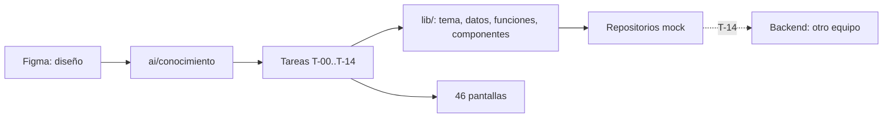

# Grafo de conocimiento · AboGator Frontend

Mapa navegable del proyecto: qué existe, dónde está y con qué se relaciona. **Se actualiza cada vez que se crea, mueve, renombra o elimina algo** (reglas en `ai/conocimiento/06-grafo-de-conocimiento.md`). Si algo de aquí no coincide con la realidad, el grafo está mal y hay que corregirlo.

Última actualización: 2026-11-18 · por Claude Code · tarea: T-00

## Cómo leerlo
- Cada fila es un **nodo** con un ID único. La columna **Relaciones** son las **aristas**: `→` apunta a otro nodo, con un verbo corto (`usa`, `muestra`, `navega a`, `implementa`, `depende de`, `define`).
- **Estado**: `planeado` · `en curso` · `hecho` (ya mergeado a `develop`) · `obsoleto`.
- **Ruta**: ruta real en el repo. `—` si aún no existe.
- Para encontrar algo: buscar su ID o nombre en este archivo y seguir las aristas.

## Vista general

## 1 · Documentos del flujo (los mantiene Claude Chat)
| ID | Nombre | Ruta | Estado | Relaciones |
|---|---|---|---|---|
| DOC-00 | Proyecto | ai/conocimiento/00-proyecto.md | hecho | → define alcance; → EXT-FIGMA |
| DOC-01 | Flujo de trabajo | ai/conocimiento/01-flujo-de-trabajo.md | hecho | → define ramas y ciclo; → GRAFO |
| DOC-02 | Diseño: tokens | ai/conocimiento/02-diseno-tokens.md | hecho | → define TEMA |
| DOC-03 | Pantallas | ai/conocimiento/03-pantallas.md | hecho | → lista PANT-* |
| DOC-04 | Plan de tareas | ai/conocimiento/04-plan-de-tareas.md | hecho | → lista T-* |
| DOC-05 | Reglas y seguridad | ai/conocimiento/05-reglas-y-seguridad.md | hecho | → aplica a todo el código |
| DOC-06 | Reglas del grafo | ai/conocimiento/06-grafo-de-conocimiento.md | hecho | → define GRAFO |
| GRAFO | Este archivo | ai/grafo.md | hecho | ← lo actualizan Claude Chat y Claude Code |
| SIG | Tarea actual | ai/siguiente.md | en curso | → apunta a la tarea T-* vigente |
| REP | Reporte | ai/reporte.md | en curso | ← lo escribe Claude Code; → responde a SIG |

## 2 · Externos
| ID | Nombre | Dónde | Relaciones |
|---|---|---|---|
| EXT-FIGMA | Diseño de Figma | fileKey SYNAyUal3xVk4k8SEBEb7f | → fuente de PANT-*, TEMA, COMP-* |
| EXT-BACK | Backend (FastAPI) | repositorio de otros compañeros | ← lo consume REPO-* en T-14 |
| EXT-BD | Base de datos (PostgreSQL) | repositorio de otros compañeros | ← la usa EXT-BACK |
| EXT-ASSETS | Logos, Sarko, íconos, fuentes | por exportar de Figma | → los usan COMP-SARKO y TEMA |

## 3 · Tareas
| ID | Rama | Estado | Pantallas / áreas | Depende de |
|---|---|---|---|---|
| T-00 | 00-base-del-proyecto | en curso | proyecto Flutter, TEMA, DATOS, RUTAS | — |
| T-01 | 01-componentes-base | planeado | COMP-* | T-00 |
| T-02 | 02-bienvenida | planeado | PANT-01..04 | T-01 |
| T-03 | 03-acceso | planeado | PANT-05, PANT-06 | T-01 |
| T-04 | 04-inicio-y-mapa | planeado | PANT-07, 07b, 08, 09 | T-01 |
| T-05 | 05-tarjeta-swipe | planeado | PANT-10, 11, 11b, 11c, 13 | T-01 |
| T-06 | 06-veredictos | planeado | PANT-12, 12b, 12c, 14, 14b, 19, 19b | T-05 |
| T-07 | 07-evidencia-y-comodines | planeado | PANT-15, 16, 16b, 17, 18, 10b, 10c | T-05 |
| T-08 | 08-vidas-y-offline | planeado | PANT-20, 23 | T-06 |
| T-09 | 09-apelaciones | planeado | PANT-21b, 21, 22, 22b | T-06 |
| T-10 | 10-tienda-perfil-ajustes | planeado | PANT-24, 25, 26, 26b | T-01 |
| T-11 | 11-nivel-jefe | planeado | PANT-27, 28, 28b, 28c, 29, 30 | T-05 |
| T-12 | 12-tablet | planeado | variantes de tablet | T-02..T-11 |
| T-13 | 13-accesibilidad-y-pulido | planeado | todas | T-12 |
| T-14 | 14-integracion-api | planeado | REPO-* → HTTP | EXT-BACK listo |

## 4 · Código (lo mantiene Claude Code; todo `—` hasta que exista)
| ID | Nombre | Ruta | Estado | Relaciones |
|---|---|---|---|---|
| MAIN | Punto de entrada (orientación vertical, ProviderScope) | lib/main.dart | en curso | → arranca APP |
| APP | App y configuración (MaterialApp.router, es_MX, tema claro/oscuro) | lib/app/app.dart | en curso | → usa ENRUTADOR, TEMA, MODO-TEMA, TEXTOS |
| ENRUTADOR | GoRouter (proveedor Riverpod); en T-00 solo la ruta `/` | lib/app/enrutador.dart | en curso | → usa RUTAS; → navega a PANT-PRUEBA |
| RUTAS | Constantes de rutas de todas las pantallas (sin implementar) | lib/app/rutas.dart | en curso | → nombra PANT-*; ← lo usa ENRUTADOR |
| TEMA | Tema claro/oscuro y tokens | lib/core/tema/ | en curso | ← define DOC-02; → lo usan todos los COMP-* y PANT-* |
| TEMA-TOKENS | 14 tokens de color (ThemeExtension `TokensColor.claro/oscuro`) | lib/core/tema/tokens_color.dart | en curso | ← define DOC-02; ← verifica TEST-TEMA |
| TEMA-MARCA | Colores de marca (15) y de módulo (5), solo decorativos | lib/core/tema/colores_marca.dart | en curso | ← define DOC-02; → lo usa MOCK-PROG |
| TEMA-TIPO | 11 estilos de texto (`TipografiaBase`, `EstilosTexto`) y resolutor de fuentes | lib/core/tema/tipografia.dart | en curso | → usa DEC-FUENTES; ← verifica TEST-TEMA |
| TEMA-APP | Construcción del `ThemeData` a partir de los tokens | lib/core/tema/tema_app.dart | en curso | → usa TEMA-TOKENS, TEMA-TIPO; ← lo usa APP |
| MODO-TEMA | Proveedor del modo claro/oscuro (sigue al sistema; se fuerza en T-10) | lib/core/tema/modo_tema.dart | en curso | ← lo usan APP y PANT-PRUEBA; → lo usará PANT-26 |
| TEXTOS | Textos centralizados | lib/core/textos/textos.dart | en curso | → los usan las pantallas y MOCK-* |
| UTIL | Extensiones de contexto (`context.tokens`, `context.estilos`) | lib/core/utilidades/extensiones_contexto.dart | en curso | → usa TEMA-TOKENS, TEMA-TIPO |
| MOD | Modelos de datos (Usuario, Modulo, Sprint, Tarjeta, EstadoStartup, Vidas, Apelacion, ArticuloTienda) | lib/datos/modelos/ | en curso | → los usan REPO-* |
| REPO-* | Interfaces de repositorio (auth, progreso, tarjetas, vidas, apelaciones, tienda) | lib/datos/repositorios/ | en curso | → implementan MOCK-*; en T-14 → HTTP |
| REPO-AUTH | Autenticación (inicio de sesión, registro con dos consentimientos) | lib/datos/repositorios/repositorio_autenticacion.dart | en curso | → usa MOD; ← implementa MOCK-AUTH; → servirá a PANT-05, PANT-06 |
| REPO-PROG | Progreso: módulos, sprints y estado de la Startup | lib/datos/repositorios/repositorio_progreso.dart | en curso | → usa MOD; ← implementa MOCK-PROG; → servirá a PANT-07..09 |
| REPO-TARJ | Tarjetas de un sprint | lib/datos/repositorios/repositorio_tarjetas.dart | en curso | → usa MOD; ← implementa MOCK-TARJ; → servirá a PANT-10..19b |
| REPO-VIDAS | Vidas (regeneración del servidor) | lib/datos/repositorios/repositorio_vidas.dart | en curso | → usa MOD; ← implementa MOCK-VIDAS; → servirá a PANT-20 |
| REPO-APEL | Apelaciones pendientes | lib/datos/repositorios/repositorio_apelaciones.dart | en curso | → usa MOD; ← implementa MOCK-APEL; → servirá a PANT-21..22b |
| REPO-TIENDA | Tienda de comodines y monedas | lib/datos/repositorios/repositorio_tienda.dart | en curso | → usa MOD; ← implementa MOCK-TIENDA; → servirá a PANT-24 |
| PROV-REPO | Proveedores Riverpod: único lugar donde se elige mock o HTTP | lib/datos/repositorios/proveedores_repositorios.dart | en curso | → expone REPO-*; → hoy usa MOCK-*; en T-14 → HTTP |
| MOCK-* | Repositorios simulados | lib/datos/mocks/ | en curso | → implementan REPO-* |
| MOCK-AUTH | Autenticación simulada (rechaza registro sin ambos consentimientos) | lib/datos/mocks/mock_autenticacion.dart | en curso | → implementa REPO-AUTH; → usa TEXTOS |
| MOCK-PROG | 5 módulos y estado de la Startup de ejemplo | lib/datos/mocks/mock_progreso.dart | en curso | → implementa REPO-PROG; → usa TEMA-MARCA |
| MOCK-TARJ | Tarjetas de ejemplo (incluye "Librería GPL en app cerrada") | lib/datos/mocks/mock_tarjetas.dart | en curso | → implementa REPO-TARJ |
| MOCK-VIDAS | Vidas con hora del servidor simulada | lib/datos/mocks/mock_vidas.dart | en curso | → implementa REPO-VIDAS |
| MOCK-APEL | Dos apelaciones de ejemplo | lib/datos/mocks/mock_apelaciones.dart | en curso | → implementa REPO-APEL |
| MOCK-TIENDA | Los tres comodines | lib/datos/mocks/mock_tienda.dart | en curso | → implementa REPO-TIENDA |
| PANT-PRUEBA | Pantalla temporal "Tema de prueba" (se elimina en T-02) | lib/funciones/bienvenida/pantalla_prueba.dart | en curso | → usa TEMA, MODO-TEMA, TEXTOS, UTIL; ← verifica TEST-PRUEBA |
| FUNC | Carpetas por área (bienvenida, acceso, inicio, juego, apelaciones, tienda, perfil, jefe) | lib/funciones/ | en curso | → contendrán PANT-* |
| COMP-* | Componentes reutilizables (botones, campos, chips HUD, corazones, indicadores, navegación inferior, Sarko, paginador) | lib/componentes/ | — | → los usan PANT-*; → usan TEMA |
| COMP-SARKO | Sarko (marcador hasta tener imágenes) | lib/componentes/ | — | ← EXT-ASSETS |
| TEST-TEMA | Pruebas del tema (hex de los 14 tokens, 11 estilos) | test/core/tema/ | en curso | → verifican TEMA-TOKENS, TEMA-TIPO |
| TEST-PRUEBA | Prueba de widget de la pantalla de prueba (claro, oscuro, sistema, texto dinámico) | test/funciones/bienvenida/pantalla_prueba_test.dart | en curso | → verifica PANT-PRUEBA, APP, MODO-TEMA |
| TEST-DATOS | Pruebas de los mocks y de la sustitución de proveedores | test/datos/mocks_test.dart | en curso | → verifican MOCK-*, PROV-REPO |
| CI | Flujo de integración continua (pub get, formato, analyze, test; Flutter 3.50.0) | .github/workflows/ci.yml | en curso | → ejecuta TEST-*; → usa CONF |
| CONF | Configuración del proyecto (dependencias, reglas de análisis, formato a 100 columnas) | pubspec.yaml, analysis_options.yaml | en curso | → define DEP-*; ← lo usa CI |
| PLAT | Proyectos nativos generados por `flutter create` (mx.abogator.abogator) | android/, ios/ | en curso | ← arranca MAIN |
| DEP-RIVERPOD | flutter_riverpod 3.5.0 (estado e inyección de repositorios) | pubspec.yaml | en curso | ← lo usan APP, MODO-TEMA, PROV-REPO |
| DEP-GOROUTER | go_router 18.1.4 | pubspec.yaml | en curso | ← lo usa ENRUTADOR |
| DEP-MATERIAL-UI | material_ui 1.x (reemplaza a `package:flutter/material.dart`, obsoleto en Flutter 3.50) | pubspec.yaml | en curso | ← lo usa todo lib/; → DEC-MATERIAL-UI |
| DEC-FUENTES | Decisión: fuentes con google_fonts 9.0.0 en desarrollo; pasar a assets/fuentes/ más adelante (reporte T-00, D1) | lib/core/tema/tipografia.dart | en curso | → usa EXT-ASSETS (fuentes pendientes) |
| DEC-MATERIAL-UI | Decisión: importar `package:material_ui/material_ui.dart` porque `flutter/material.dart` está obsoleto (reporte T-00, D2) | — | en curso | → DEP-MATERIAL-UI |

## 5 · Pantallas (46, según Figma) y a dónde llevan
Código de cada pantalla: `lib/funciones/<área>/` (— hasta que exista).

| ID | Pantalla | Tarea | Navega a |
|---|---|---|---|
| PANT-01 | Splash | T-02 | 02 (a los 2 s) |
| PANT-02 | Onboarding 1: Sarko se presenta | T-02 | 03 · Omitir → 05 |
| PANT-03 | Onboarding 2: swipe en 4 direcciones | T-02 | 03b · Omitir → 05 |
| PANT-03b | Onboarding 3: indicadores de la Startup | T-02 | 04 · Omitir → 05 |
| PANT-04 | Onboarding 4: vidas y apelaciones | T-02 | 05 |
| PANT-05 | Inicio de sesión | T-03 | 07 · Crear cuenta → 06 |
| PANT-06 | Registro (dos consentimientos separados) | T-03 | 07 · Iniciar sesión → 05 |
| PANT-07 | Inicio: mapa de módulos | T-04 | 08 · pestañas 21, 24, 25 |
| PANT-07b | Inicio en modo oscuro | T-04 | igual que 07 |
| PANT-08 | Mapa de sprints | T-04 | 09 · nodo Examen final → 27 |
| PANT-09 | Intro del sprint | T-04 | 10 |
| PANT-10 | Tarjeta normal | T-05 | 11, 13, 11b, 11c |
| PANT-11 | Arrastrando a Ilegal (←) | T-05 | 12 o 14 |
| PANT-11b | Arrastrando a Condicional (↑) | T-05 | 12, 12c o 14 |
| PANT-11c | Arrastrando a Escalar (↓) | T-05 | 12, 12c o 14 |
| PANT-13 | Arrastrando a Legal (→) | T-05 | 12 o 14 |
| PANT-12 | Veredicto correcto (¿Por qué?) | T-06 | 12b o siguiente tarjeta |
| PANT-12b | Bonus ganado (+5 XP) | T-06 | siguiente tarjeta |
| PANT-12c | Respuesta parcial | T-06 | siguiente tarjeta |
| PANT-14 | Veredicto incorrecto (−1 vida) | T-06 | siguiente · Riesgo 100% → 19b · vidas 0 → 20 |
| PANT-14b | Amparo activado | T-06 | siguiente tarjeta |
| PANT-19 | Sprint completado | T-06 | 08 · Repasar fallos → 21 |
| PANT-19b | Startup en quiebra | T-06 | 09 · buzón → 21 |
| PANT-15 | Tarjeta con evidencia | T-07 | 16 |
| PANT-16 | Inspeccionar evidencia | T-07 | 16b · volver a 15 |
| PANT-16b | Línea subrayada | T-07 | volver y decidir (15) |
| PANT-17 | Tarjeta de justificación | T-07 | 18 |
| PANT-18 | Justificar veredicto | T-07 | 12b |
| PANT-10b | Comodín Lupa de Auditor | T-07 | 10 |
| PANT-10c | Comodín Abogado Senior | T-07 | 10 |
| PANT-20 | Sin vidas (cuenta regresiva del servidor) | T-08 | 21 · volver |
| PANT-23 | Sin conexión (offline-first) | T-08 | tarjeta normal |
| PANT-21b | Notificación de apelación | T-09 | 22 |
| PANT-21 | Buzón de Apelaciones | T-09 | 22 |
| PANT-22 | Juicio de apelación | T-09 | 22b |
| PANT-22b | Apelación ganada (+1 vida) | T-09 | 21 |
| PANT-24 | Tienda | T-10 | pestañas |
| PANT-25 | Perfil y progreso | T-10 | 26 |
| PANT-26 | Ajustes de accesibilidad | T-10 | 25 |
| PANT-26b | Navegación por teclado y foco | T-10 | — |
| PANT-27 | Crisis: ransomware | T-11 | 28 · ahora no → 08 |
| PANT-28 | Decisión de crisis | T-11 | 28b |
| PANT-28b | Contraargumento del Jefe | T-11 | 28c |
| PANT-28c | Golpe al Jefe (−20 HP) | T-11 | 28 · HP 0 → 29 · 0 vidas o tiempo → 30 |
| PANT-29 | Auditoría superada (certificado) | T-11 | 07 (Módulo 2) |
| PANT-30 | La Inspectora ganó | T-11 | 21 |

## 6 · Conceptos del juego (para saber qué pantallas los tocan)
| ID | Concepto | Pantallas que lo muestran | Reglas |
|---|---|---|---|
| CON-SWIPE | Swipe en 4 direcciones | 03, 10, 11*, 13, 22, 28 | → Legal, ← Ilegal, ↑ Condicional, ↓ Escalar; siempre con botón equivalente |
| CON-VIDAS | Vidas (máx. 5, +1 cada 2 h, tiempo del servidor) | 04, 14, 20, 22b, 30 | — |
| CON-STARTUP | Indicadores (Presupuesto, Reputación, Velocidad, Riesgo legal) | 03b, 10, 12, 14, 19b | Riesgo 100% o sin presupuesto → quiebra |
| CON-APELA | Apelaciones (día 3, 7 y 14) | 21, 21b, 22, 22b | +1 vida al ganar; no avanzan el mapa |
| CON-COMODIN | Comodines (Lupa, Abogado, Amparo) | 10b, 10c, 14b, 24 | Desactivados en el Examen Final (RN03) |
| CON-JEFE | Nivel Jefe de 72 h | 27, 28, 28b, 28c, 29, 30 | 10 decisiones de 15 s (22 s con tiempo extendido) |
| CON-OFFLINE | Modo sin conexión | 23 | Respuestas en SQLite con UUID de cliente |

## Registro de cambios del grafo
- 2026-11-18 · Claude Chat · creación del grafo con documentos, tareas, pantallas y conceptos; código aún sin nodos reales.
- 2026-11-18 · Claude Code · T-00: rutas reales y estado `en curso` para APP, RUTAS, TEMA, TEXTOS, MOD, REPO-*, MOCK-*, TEST-TEMA y CI. Nodos nuevos: MAIN, ENRUTADOR, TEMA-TOKENS, TEMA-MARCA, TEMA-TIPO, TEMA-APP, MODO-TEMA, UTIL, REPO-AUTH/PROG/TARJ/VIDAS/APEL/TIENDA, PROV-REPO, MOCK-AUTH/PROG/TARJ/VIDAS/APEL/TIENDA, PANT-PRUEBA, FUNC, TEST-PRUEBA, TEST-DATOS, CONF, PLAT, DEP-RIVERPOD, DEP-GOROUTER, DEP-MATERIAL-UI, DEC-FUENTES y DEC-MATERIAL-UI. COMP-* y COMP-SARKO siguen sin ruta (`lib/componentes/` solo tiene `.gitkeep` hasta T-01).
