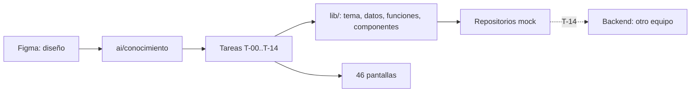

# Grafo de conocimiento · AboGator Frontend

Mapa navegable del proyecto: qué existe, dónde está y con qué se relaciona. **Se actualiza cada vez que se crea, mueve, renombra o elimina algo** (reglas en `ai/conocimiento/06-grafo-de-conocimiento.md`). Si algo de aquí no coincide con la realidad, el grafo está mal y hay que corregirlo.

Última actualización: 2026-11-19 · por Claude Chat · tarea: planeación de FIX-02

## Cómo leerlo
- Cada fila es un **nodo** con un ID único. La columna **Relaciones** son las **aristas**: `→` apunta a otro nodo, con un verbo corto (`usa`, `muestra`, `navega a`, `implementa`, `depende de`, `define`).
- **Estado**: `planeado` · `en curso` · `hecho` (ya mergeado a `develop`) · `obsoleto`.
- **Ruta**: ruta real en el repo. `—` si aún no existe.
- Para encontrar algo: buscar su ID o nombre en este archivo y seguir las aristas.

## Vista general

## 1 · Documentos del flujo (los mantiene Claude Chat)
| ID | Nombre | Ruta | Estado | Relaciones |
|---|---|---|---|---|
| DOC-00 | Proyecto | ai/conocimiento/00-proyecto.md | hecho | → define alcance; → EXT-FIGMA |
| DOC-01 | Flujo de trabajo | ai/conocimiento/01-flujo-de-trabajo.md | hecho | → define ramas y ciclo; → GRAFO |
| DOC-02 | Diseño: tokens | ai/conocimiento/02-diseno-tokens.md | hecho | → define TEMA |
| DOC-03 | Pantallas | ai/conocimiento/03-pantallas.md | hecho | → lista PANT-* |
| DOC-04 | Plan de tareas | ai/conocimiento/04-plan-de-tareas.md | hecho | → lista T-* |
| DOC-05 | Reglas y seguridad | ai/conocimiento/05-reglas-y-seguridad.md | hecho | → aplica a todo el código |
| DOC-06 | Reglas del grafo | ai/conocimiento/06-grafo-de-conocimiento.md | hecho | → define GRAFO |
| DOC-07 | Especificación de componentes | ai/conocimiento/07-componentes.md | hecho | → define COMP-*; ← lo usan T-01 y las tareas de pantallas |
| GRAFO | Este archivo | ai/grafo.md | hecho | ← lo actualizan Claude Chat y Claude Code |
| SIG | Tarea actual (FIX-02: imágenes de logos y Sarko) | ai/siguiente.md | en curso | → apunta a la tarea vigente |
| REP | Reporte | ai/reporte.md | en curso | ← lo escribe Claude Code; → responde a SIG |

## 2 · Externos
| ID | Nombre | Dónde | Relaciones |
|---|---|---|---|
| EXT-FIGMA | Diseño de Figma | fileKey SYNAyUal3xVk4k8SEBEb7f | → fuente de PANT-*, TEMA, COMP-* |
| EXT-BACK | Backend (FastAPI) | repositorio de otros compañeros | ← lo consume REPO-* en T-14 |
| EXT-BD | Base de datos (PostgreSQL) | repositorio de otros compañeros | ← la usa EXT-BACK |
| EXT-ASSETS | Logos, poses de Sarko, íconos y fuentes | Originales de Figma en la computadora del usuario (`Imegenes/Logo-Isotipo/`, fuera de git); copias renombradas en `assets/imagenes/` (FIX-02). Íconos: Lucide. Fuentes: `assets/fuentes/`. Pendiente: reexportar a 3x | → los usan COMP-SARKO, COMP-ICONO, COMP-LOGO y TEMA-TIPO |

## 3 · Tareas
| ID | Rama | Estado | Pantallas / áreas | Depende de |
|---|---|---|---|---|
| T-00 | 00-base-del-proyecto | hecho | proyecto Flutter, TEMA, DATOS, RUTAS | — |
| T-01 | 01-componentes-base | hecho | COMP-*, fuentes locales, íconos, imágenes, plataforma web de desarrollo | T-00 |
| T-02 | 02-bienvenida | en curso | PANT-01..04, COMP-VEREDICTO, token estado/escalar | T-01 |
| T-03 | 03-acceso | planeado | PANT-05, PANT-06 | T-01 |
| T-04 | 04-inicio-y-mapa | planeado | PANT-07, 07b, 08, 09 | T-01 |
| T-05 | 05-tarjeta-swipe | planeado | PANT-10, 11, 11b, 11c, 13 | T-01 |
| T-06 | 06-veredictos | planeado | PANT-12, 12b, 12c, 14, 14b, 19, 19b | T-05 |
| T-07 | 07-evidencia-y-comodines | planeado | PANT-15, 16, 16b, 17, 18, 10b, 10c | T-05 |
| T-08 | 08-vidas-y-offline | planeado | PANT-20, 23 | T-06 |
| T-09 | 09-apelaciones | planeado | PANT-21b, 21, 22, 22b | T-06 |
| T-10 | 10-tienda-perfil-ajustes | planeado | PANT-24, 25, 26, 26b | T-01 |
| T-11 | 11-nivel-jefe | planeado | PANT-27, 28, 28b, 28c, 29, 30 | T-05 |
| T-12 | 12-tablet | planeado | variantes de tablet | T-02..T-11 |
| T-13 | 13-accesibilidad-y-pulido | planeado | todas | T-12 |
| T-14 | 14-integracion-api | planeado | REPO-* → HTTP | EXT-BACK listo |

## 4 · Código (lo mantiene Claude Code)
| ID | Nombre | Ruta | Estado | Relaciones |
|---|---|---|---|---|
| MAIN | Punto de entrada (orientación vertical, ProviderScope) | lib/main.dart | hecho | → arranca APP |
| APP | App y configuración (MaterialApp.router, es_MX, tema claro/oscuro) | lib/app/app.dart | hecho | → usa ENRUTADOR, TEMA, MODO-TEMA, TEXTOS |
| ENRUTADOR | GoRouter (proveedor Riverpod): arranca en `/splash`; `/` redirige al Splash; onboarding, marcador de inicio de sesión y `/galeria` solo en debug | lib/app/enrutador.dart | en curso | → usa RUTAS; → navega a PANT-01, PANT-02..04, PANT-PENDIENTE, PANT-GALERIA |
| RUTAS | Constantes de rutas de todas las pantallas; T-02 agrega `galeria` y usa `splash`, `onboarding` e `inicioSesion` | lib/app/rutas.dart | en curso | → nombra PANT-*; ← lo usa ENRUTADOR |
| PANT-PENDIENTE | Marcador temporal de pantallas que llegan en otra tarea (hoy: inicio de sesión, hasta T-03) | lib/app/pantalla_pendiente.dart | en curso | ← lo usa ENRUTADOR; → se reemplaza por PANT-05 en T-03 |
| TEMA | Tema claro/oscuro y tokens | lib/core/tema/ | hecho | ← define DOC-02; → lo usan todos los COMP-* y PANT-* |
| TEMA-TOKENS | 18 tokens de color (ThemeExtension `TokensColor.claro/oscuro`; T-01 agrega borde/control, estado/condicional y foco/anillo; T-02 agrega estado/escalar) | lib/core/tema/tokens_color.dart | en curso | ← define DOC-02, DOC-07; ← verifica TEST-TEMA |
| TEMA-MARCA | Colores de marca (15) y de módulo (5), solo decorativos | lib/core/tema/colores_marca.dart | hecho | ← define DOC-02; → lo usa MOCK-PROG |
| TEMA-TIPO | 11 estilos de texto (`TipografiaBase`, `EstilosTexto`); tracking 0.2 en Botón, Etiqueta y Leyenda; fuentes locales | lib/core/tema/tipografia.dart | hecho | → usa ASSETS-FUENTES; → DEC-FUENTES; ← verifica TEST-TEMA |
| TEMA-APP | Construcción del `ThemeData` a partir de los tokens | lib/core/tema/tema_app.dart | hecho | → usa TEMA-TOKENS, TEMA-TIPO; ← lo usa APP |
| TEMA-EFECTOS | Efectos que no son tokens: sombras (botón, veredicto, tarjeta de caso), brillo de barra, opacidades (chips, etiqueta de caso, puntos del Splash), duración con "reducir animaciones" | lib/core/tema/efectos.dart | en curso | ← lo usan COMP-BOTON, COMP-VEREDICTO, COMP-PROGRESO, COMP-PAGINADOR, COMP-IMPACTO, PANT-01, PANT-02..04 |
| TEMA-ICONOS | Catálogo `IconosApp` (45 nombres de Figma → Lucide, más eyeOff) | lib/core/tema/iconos_app.dart | hecho | → usa DEP-LUCIDE; ← lo usan COMP-ICONO y los COMP-* |
| MODO-TEMA | Proveedor del modo claro/oscuro (sigue al sistema; se fuerza en T-10) | lib/core/tema/modo_tema.dart | hecho | ← lo usan APP y PANT-GALERIA; → lo usará PANT-26 |
| TEXTOS | Textos centralizados (componentes, galería, Splash, onboarding y marcadores) | lib/core/textos/textos.dart | en curso | → los usan las pantallas y MOCK-* |
| UTIL | Extensiones de contexto (`context.tokens`, `context.estilos`) | lib/core/utilidades/extensiones_contexto.dart | hecho | → usa TEMA-TOKENS, TEMA-TIPO |
| UTIL-CONTRASTE | Cálculo de contraste WCAG 2.1 | lib/core/utilidades/contraste.dart | hecho | ← lo usa TEST-TEMA |
| RECURSOS | Rutas de las imágenes (`ImagenesApp`) | lib/core/recursos/imagenes_app.dart | hecho | → apunta a ASSETS-IMG; ← lo usan COMP-SARKO, COMP-LOGO |
| MOD | Modelos de datos (Usuario, Modulo, Sprint, Tarjeta, EstadoStartup, Vidas, Apelacion, ArticuloTienda) | lib/datos/modelos/ | hecho | → los usan REPO-* |
| REPO-* | Interfaces de repositorio (auth, progreso, tarjetas, vidas, apelaciones, tienda) | lib/datos/repositorios/ | hecho | → implementan MOCK-*; en T-14 → HTTP |
| REPO-AUTH | Autenticación (inicio de sesión, registro con dos consentimientos) | lib/datos/repositorios/repositorio_autenticacion.dart | hecho | → usa MOD; ← implementa MOCK-AUTH; → servirá a PANT-05, PANT-06 |
| REPO-PROG | Progreso: módulos, sprints y estado de la Startup | lib/datos/repositorios/repositorio_progreso.dart | hecho | → usa MOD; ← implementa MOCK-PROG; → servirá a PANT-07..09 |
| REPO-TARJ | Tarjetas de un sprint | lib/datos/repositorios/repositorio_tarjetas.dart | hecho | → usa MOD; ← implementa MOCK-TARJ; → servirá a PANT-10..19b |
| REPO-VIDAS | Vidas (regeneración del servidor) | lib/datos/repositorios/repositorio_vidas.dart | hecho | → usa MOD; ← implementa MOCK-VIDAS; → servirá a PANT-20 |
| REPO-APEL | Apelaciones pendientes | lib/datos/repositorios/repositorio_apelaciones.dart | hecho | → usa MOD; ← implementa MOCK-APEL; → servirá a PANT-21..22b |
| REPO-TIENDA | Tienda de comodines y monedas | lib/datos/repositorios/repositorio_tienda.dart | hecho | → usa MOD; ← implementa MOCK-TIENDA; → servirá a PANT-24 |
| REPO-ONBOARDING | Estado "onboarding visto" (`fueVisto`, `marcarVisto`) | lib/datos/repositorios/repositorio_onboarding.dart | en curso | ← implementa MEM-ONBOARDING; ← lo usa FLUJO-BIENVENIDA; en T-08 → SQLite |
| PROV-REPO | Proveedores Riverpod: único lugar donde se elige mock o HTTP (T-02 agrega el de onboarding) | lib/datos/repositorios/proveedores_repositorios.dart | en curso | → expone REPO-*; → hoy usa MOCK-* y MEM-ONBOARDING; en T-14 → HTTP |
| MOCK-* | Repositorios simulados | lib/datos/mocks/ | hecho | → implementan REPO-* |
| MOCK-AUTH | Autenticación simulada (rechaza registro sin ambos consentimientos) | lib/datos/mocks/mock_autenticacion.dart | hecho | → implementa REPO-AUTH; → usa TEXTOS |
| MOCK-PROG | 5 módulos y estado de la Startup de ejemplo | lib/datos/mocks/mock_progreso.dart | hecho | → implementa REPO-PROG; → usa TEMA-MARCA |
| MOCK-TARJ | Tarjetas de ejemplo (incluye "Librería GPL en app cerrada") | lib/datos/mocks/mock_tarjetas.dart | hecho | → implementa REPO-TARJ |
| MOCK-VIDAS | Vidas con hora del servidor simulada | lib/datos/mocks/mock_vidas.dart | hecho | → implementa REPO-VIDAS |
| MOCK-APEL | Dos apelaciones de ejemplo | lib/datos/mocks/mock_apelaciones.dart | hecho | → implementa REPO-APEL |
| MOCK-TIENDA | Los tres comodines | lib/datos/mocks/mock_tienda.dart | hecho | → implementa REPO-TIENDA |
| MEM-ONBOARDING | Implementación en memoria del estado "onboarding visto" (dura mientras la app está abierta) | lib/datos/mocks/onboarding_en_memoria.dart | en curso | → implementa REPO-ONBOARDING |
| PANT-PRUEBA | Pantalla temporal "Tema de prueba" (eliminada en T-01; la reemplaza PANT-GALERIA) | — | obsoleto | → reemplazada por PANT-GALERIA |
| PANT-GALERIA | Galería temporal de componentes (todos los tipos y estados, claro/oscuro); ruta `/galeria` solo en debug; se elimina con las pantallas reales | lib/funciones/bienvenida/galeria_componentes.dart | en curso | → usa COMP-*, MODO-TEMA, TEXTOS, TEMA-ICONOS; ← verifica TEST-GALERIA |
| FLUJO-BIENVENIDA | Reglas del flujo Splash → Onboarding → Inicio de sesión (destino tras el Splash, terminar onboarding) | lib/funciones/bienvenida/flujo_bienvenida.dart | en curso | → usa REPO-ONBOARDING, RUTAS; ← lo usan PANT-01 y PANT-02..04 |
| CODIGO-PANT-01 | Pantalla 01 Splash (logo marcador, lema, puntos de carga, avance a los 2 s) | lib/funciones/bienvenida/pantalla_splash.dart | en curso | → implementa PANT-01; → usa COMP-LOGO, FLUJO-BIENVENIDA, TEMA-EFECTOS |
| CODIGO-PANT-02..04 | Pantallas 02, 03, 03b y 04 Onboarding (un `PageView`, Omitir, paginador y botón) | lib/funciones/bienvenida/pantalla_onboarding.dart | en curso | → implementa PANT-02, PANT-03, PANT-03b, PANT-04; → usa COMP-BOTON, COMP-PAGINADOR, COMP-FOCO, FLUJO-BIENVENIDA, ILUS-ONBOARDING |
| ILUS-ONBOARDING | Ilustraciones decorativas del onboarding (lienzo 390×400, miniatura de tarjeta de caso) | lib/funciones/bienvenida/ilustraciones_onboarding.dart | en curso | → usa COMP-SARKO, COMP-VEREDICTO, COMP-INDICADORES, COMP-CORAZON, COMP-CHIP |
| FUNC | Carpetas por área (bienvenida, acceso, inicio, juego, apelaciones, tienda, perfil, jefe) | lib/funciones/ | hecho | → contendrán PANT-* |
| COMP-* | Componentes reutilizables (un archivo por componente) | lib/componentes/ | hecho | ← define DOC-07; → los usan PANT-*; → usan TEMA, TEXTOS |
| COMP-BOTON | `BotonApp`: primario, secundario, acento, peligro, fantasma y deshabilitado; estado presionado | lib/componentes/boton_app.dart | hecho | → usa COMP-FOCO, COMP-ICONO, TEMA-EFECTOS; → DEC-PRESIONADO |
| COMP-CAMPO | `CampoTextoApp`: reposo, foco, error; tipos texto/nombre/correo/contraseña | lib/componentes/campo_texto_app.dart | hecho | → usa COMP-FOCO, COMP-ICONO |
| COMP-CHIP | `ChipHud`: vidas, monedas, racha, comodines, amparo | lib/componentes/chip_hud.dart | hecho | → usa COMP-CORAZON, COMP-ICONO |
| COMP-CORAZON | `CorazonVida` y `FilaVidas` (silueta de Lucide dibujada para poder rellenarla) | lib/componentes/corazon_vida.dart | hecho | → usa MOD (Vidas.maximo); ← lo usa COMP-CHIP |
| COMP-INDICADORES | `IndicadoresStartup` y enum `IndicadorStartup` | lib/componentes/indicadores_startup.dart | hecho | → usa MOD (EstadoStartup), COMP-ICONO; → DEC-INDICADORES |
| COMP-IMPACTO | `ImpactoStartup`: chips con signo y color tras un veredicto | lib/componentes/impacto_startup.dart | hecho | → usa COMP-INDICADORES, TEMA-EFECTOS |
| COMP-NAV | `NavegacionInferiorApp`: Mapa, Buzón, Tienda, Perfil | lib/componentes/navegacion_inferior_app.dart | hecho | → usa COMP-FOCO, COMP-ICONO; → navegará a PANT-07, 21, 24, 25; → DEC-ZONA-SEGURA |
| COMP-PROGRESO | `BarraProgreso` con brillo y animación | lib/componentes/barra_progreso.dart | hecho | → usa TEMA-EFECTOS |
| COMP-PAGINADOR | `PaginadorPuntos` | lib/componentes/paginador_puntos.dart | hecho | ← lo usa CODIGO-PANT-02..04 |
| COMP-FOCO | `AnilloFoco`: anillo de 3 en foco/anillo a 2 del control | lib/componentes/anillo_foco.dart | hecho | ← lo usan COMP-BOTON, COMP-CAMPO, COMP-NAV |
| COMP-ICONO | `IconoApp` (decorativo sin etiqueta) | lib/componentes/icono_app.dart | hecho | → usa TEMA-ICONOS |
| COMP-SARKO | `SarkoImagen` y enum `PoseSarko` (alegre, enojado, sorprendido, triste), con texto alternativo y marcador | lib/componentes/sarko_imagen.dart | hecho | → usa RECURSOS, ASSETS-IMG; ← EXT-ASSETS |
| COMP-LOGO | `LogoApp`: vertical (proporciones de Figma desde T-02), horizontal e isotipo | lib/componentes/logo_app.dart | en curso | → usa RECURSOS, ASSETS-IMG; ← lo usa CODIGO-PANT-01 |
| COMP-VEREDICTO | `BotonVeredicto`: ilegal, legal, condicional y escalar; decorativo sin `alPresionar`, con anillo de foco y nombre accesible con él | lib/componentes/boton_veredicto.dart | en curso | → usa MOD (Veredicto), COMP-FOCO, COMP-ICONO, TEMA-EFECTOS; ← lo usan ILUS-ONBOARDING y PANT-GALERIA; → lo usará PANT-10 |
| ASSETS-IMG | Logos, ícono de app y poses de Sarko (movidos desde `Imegenes/`) | assets/imagenes/ | hecho | ← EXT-ASSETS; ← lo usan COMP-SARKO, COMP-LOGO |
| ASSETS-FUENTES | Fredoka (600, 700), Inter (400–700), JetBrains Mono (400) y licencias OFL | assets/fuentes/ | hecho | ← EXT-ASSETS; ← lo usa TEMA-TIPO |
| TEST-TEMA | Pruebas del tema (hex de los 18 tokens, contraste de los tokens nuevos, 11 estilos y tracking) | test/core/tema/ | en curso | → verifican TEMA-TOKENS, TEMA-TIPO; → usa UTIL-CONTRASTE |
| TEST-PRUEBA | Prueba de la pantalla de prueba (eliminada en T-01 junto con PANT-PRUEBA) | — | obsoleto | → reemplazada por TEST-GALERIA |
| TEST-GALERIA | Galería (se abre en `/galeria`): todos los componentes, claro/oscuro, navegación y texto al 200 % sin desbordes | test/funciones/bienvenida/galeria_componentes_test.dart | en curso | → verifica PANT-GALERIA, APP, MODO-TEMA |
| TEST-BIENVENIDA | Splash y onboarding: destino a los 2 s, onboarding visto, 4 páginas, Omitir, ¡Comenzar!, foco, semántica, texto al 200 % en 390×844 y 360×640 | test/funciones/bienvenida/bienvenida_test.dart | en curso | → verifica CODIGO-PANT-01, CODIGO-PANT-02..04, FLUJO-BIENVENIDA |
| TEST-COMP | Pruebas de cada componente (incluye el botón de veredicto): claro y oscuro, estados, semántica, foco con teclado y solo colores del tema | test/componentes/ | en curso | → verifican COMP-*; → usa TEST-AYUDA |
| TEST-AYUDA | Ayudante de pruebas: montar en claro/oscuro y comprobar que solo se usan colores del tema | test/ayudantes/montar.dart | hecho | ← lo usa TEST-COMP |
| TEST-DATOS | Pruebas de los mocks y de la sustitución de proveedores | test/datos/mocks_test.dart | hecho | → verifican MOCK-*, PROV-REPO |
| CI | Flujo de integración continua (pub get, formato, analyze, test; Flutter 3.50.0) | .github/workflows/ci.yml | hecho | → ejecuta TEST-*; → usa CONF |
| CONF | Configuración del proyecto (dependencias, assets y fuentes, reglas de análisis, formato a 100 columnas, saltos de línea LF) | pubspec.yaml, analysis_options.yaml, .gitattributes | hecho | → define DEP-*; ← lo usa CI |
| PLAT | Proyectos nativos generados por `flutter create` (mx.abogator.abogator) | android/, ios/ | hecho | ← arranca MAIN |
| PLAT-WEB | Plataforma web solo para desarrollo (ver PANT-GALERIA en Chrome); fuera del alcance del producto | web/ | hecho | ← arranca MAIN |
| DEP-RIVERPOD | flutter_riverpod 3.5.0 (estado e inyección de repositorios) | pubspec.yaml | hecho | ← lo usan APP, MODO-TEMA, PROV-REPO |
| DEP-GOROUTER | go_router 18.1.4 | pubspec.yaml | hecho | ← lo usa ENRUTADOR |
| DEP-LUCIDE | lucide_icons_flutter 4.0.3 (íconos estilo Lucide) | pubspec.yaml | hecho | ← lo usa TEMA-ICONOS |
| DEP-MATERIAL-UI | material_ui 1.x (reemplaza a `package:flutter/material.dart`, obsoleto en Flutter 3.50) | pubspec.yaml | hecho | ← lo usa todo lib/; → DEC-MATERIAL-UI |
| DEC-FUENTES | Decisión: en T-00 se usó google_fonts; **en T-01 se quitó y se usan .ttf locales en assets/fuentes/** (la app funciona sin conexión) | lib/core/tema/tipografia.dart, assets/fuentes/ | hecho | → usa ASSETS-FUENTES |
| DEC-MATERIAL-UI | Decisión: importar `package:material_ui/material_ui.dart` porque `flutter/material.dart` está obsoleto (reporte T-00, D2) | — | hecho | → DEP-MATERIAL-UI |
| DEC-PRESIONADO | Decisión: el botón presionado baja 2 dp y su sombra pasa de 4 a 2; sin transición con "reducir animaciones" (reporte T-01) | lib/componentes/boton_app.dart | hecho | ← COMP-BOTON |
| DEC-ZONA-SEGURA | Decisión: la navegación inferior mide 58 + la zona segura del sistema (`SafeArea`), no 26 fijos (reporte T-01) | lib/componentes/navegacion_inferior_app.dart | hecho | ← COMP-NAV |
| DEC-INDICADORES | Decisión: columnas de ancho intrínseco en un `Wrap`; con texto grande o pantallas angostas pasan a dos filas en vez de cortar palabras (reporte T-01) | lib/componentes/indicadores_startup.dart | hecho | ← COMP-INDICADORES |

## 5 · Pantallas (46, según Figma) y a dónde llevan
Código de cada pantalla: `lib/funciones/<área>/` (— hasta que exista).

| ID | Pantalla | Tarea | Navega a |
|---|---|---|---|
| PANT-01 | Splash · `lib/funciones/bienvenida/pantalla_splash.dart` (en curso) | T-02 | 02 (a los 2 s) |
| PANT-02 | Onboarding 1: Sarko se presenta · `lib/funciones/bienvenida/pantalla_onboarding.dart` (en curso) | T-02 | 03 · Omitir → 05 |
| PANT-03 | Onboarding 2: swipe en 4 direcciones · `lib/funciones/bienvenida/pantalla_onboarding.dart` (en curso) | T-02 | 03b · Omitir → 05 |
| PANT-03b | Onboarding 3: indicadores de la Startup · `lib/funciones/bienvenida/pantalla_onboarding.dart` (en curso) | T-02 | 04 · Omitir → 05 |
| PANT-04 | Onboarding 4: vidas y apelaciones · `lib/funciones/bienvenida/pantalla_onboarding.dart` (en curso) | T-02 | 05 |
| PANT-05 | Inicio de sesión | T-03 | 07 · Crear cuenta → 06 |
| PANT-06 | Registro (dos consentimientos separados) | T-03 | 07 · Iniciar sesión → 05 |
| PANT-07 | Inicio: mapa de módulos | T-04 | 08 · pestañas 21, 24, 25 |
| PANT-07b | Inicio en modo oscuro | T-04 | igual que 07 |
| PANT-08 | Mapa de sprints | T-04 | 09 · nodo Examen final → 27 |
| PANT-09 | Intro del sprint | T-04 | 10 |
| PANT-10 | Tarjeta normal | T-05 | 11, 13, 11b, 11c |
| PANT-11 | Arrastrando a Ilegal (←) | T-05 | 12 o 14 |
| PANT-11b | Arrastrando a Condicional (↑) | T-05 | 12, 12c o 14 |
| PANT-11c | Arrastrando a Escalar (↓) | T-05 | 12, 12c o 14 |
| PANT-13 | Arrastrando a Legal (→) | T-05 | 12 o 14 |
| PANT-12 | Veredicto correcto (¿Por qué?) | T-06 | 12b o siguiente tarjeta |
| PANT-12b | Bonus ganado (+5 XP) | T-06 | siguiente tarjeta |
| PANT-12c | Respuesta parcial | T-06 | siguiente tarjeta |
| PANT-14 | Veredicto incorrecto (−1 vida) | T-06 | siguiente · Riesgo 100% → 19b · vidas 0 → 20 |
| PANT-14b | Amparo activado | T-06 | siguiente tarjeta |
| PANT-19 | Sprint completado | T-06 | 08 · Repasar fallos → 21 |
| PANT-19b | Startup en quiebra | T-06 | 09 · buzón → 21 |
| PANT-15 | Tarjeta con evidencia | T-07 | 16 |
| PANT-16 | Inspeccionar evidencia | T-07 | 16b · volver a 15 |
| PANT-16b | Línea subrayada | T-07 | volver y decidir (15) |
| PANT-17 | Tarjeta de justificación | T-07 | 18 |
| PANT-18 | Justificar veredicto | T-07 | 12b |
| PANT-10b | Comodín Lupa de Auditor | T-07 | 10 |
| PANT-10c | Comodín Abogado Senior | T-07 | 10 |
| PANT-20 | Sin vidas (cuenta regresiva del servidor) | T-08 | 21 · volver |
| PANT-23 | Sin conexión (offline-first) | T-08 | tarjeta normal |
| PANT-21b | Notificación de apelación | T-09 | 22 |
| PANT-21 | Buzón de Apelaciones | T-09 | 22 |
| PANT-22 | Juicio de apelación | T-09 | 22b |
| PANT-22b | Apelación ganada (+1 vida) | T-09 | 21 |
| PANT-24 | Tienda | T-10 | pestañas |
| PANT-25 | Perfil y progreso | T-10 | 26 |
| PANT-26 | Ajustes de accesibilidad | T-10 | 25 |
| PANT-26b | Orden de foco por teclado sobre la tarjeta del juego (no es una pantalla aparte; es una especificación) | T-05 y T-13 | — |
| PANT-27 | Crisis: ransomware | T-11 | 28 · ahora no → 08 |
| PANT-28 | Decisión de crisis | T-11 | 28b |
| PANT-28b | Contraargumento del Jefe | T-11 | 28c |
| PANT-28c | Golpe al Jefe (−20 HP) | T-11 | 28 · HP 0 → 29 · 0 vidas o tiempo → 30 |
| PANT-29 | Auditoría superada (certificado) | T-11 | 07 (Módulo 2) |
| PANT-30 | La Inspectora ganó | T-11 | 21 |

## 6 · Conceptos del juego (para saber qué pantallas los tocan)
| ID | Concepto | Pantallas que lo muestran | Reglas |
|---|---|---|---|
| CON-SWIPE | Swipe en 4 direcciones | 03, 10, 11*, 13, 22, 28 | → Legal, ← Ilegal, ↑ Condicional, ↓ Escalar; siempre con botón equivalente |
| CON-VIDAS | Vidas (máx. 5, +1 cada 2 h, tiempo del servidor) | 04, 14, 20, 22b, 30 | — |
| CON-STARTUP | Indicadores (Presupuesto, Reputación, Velocidad, Riesgo legal) | 03b, 10, 12, 14, 19b | Riesgo 100% o sin presupuesto → quiebra |
| CON-APELA | Apelaciones (día 3, 7 y 14) | 21, 21b, 22, 22b | +1 vida al ganar; no avanzan el mapa |
| CON-COMODIN | Comodines (Lupa, Abogado, Amparo) | 10b, 10c, 14b, 24 | Desactivados en el Examen Final (RN03) |
| CON-JEFE | Nivel Jefe de 72 h | 27, 28, 28b, 28c, 29, 30 | 10 decisiones de 15 s (22 s con tiempo extendido) |
| CON-OFFLINE | Modo sin conexión | 23 | Respuestas en SQLite con UUID de cliente |

## Registro de cambios del grafo
- 2026-11-18 · Claude Chat · creación del grafo con documentos, tareas, pantallas y conceptos; código aún sin nodos reales.
- 2026-11-18 · Claude Code · T-00: rutas reales y estado `en curso` para APP, RUTAS, TEMA, TEXTOS, MOD, REPO-*, MOCK-*, TEST-TEMA y CI. Nodos nuevos: MAIN, ENRUTADOR, TEMA-TOKENS, TEMA-MARCA, TEMA-TIPO, TEMA-APP, MODO-TEMA, UTIL, REPO-AUTH/PROG/TARJ/VIDAS/APEL/TIENDA, PROV-REPO, MOCK-AUTH/PROG/TARJ/VIDAS/APEL/TIENDA, PANT-PRUEBA, FUNC, TEST-PRUEBA, TEST-DATOS, CONF, PLAT, DEP-RIVERPOD, DEP-GOROUTER, DEP-MATERIAL-UI, DEC-FUENTES y DEC-MATERIAL-UI. COMP-* y COMP-SARKO siguen sin ruta (`lib/componentes/` solo tiene `.gitkeep` hasta T-01).
- 2026-11-18 · Claude Chat · cierre de T-00: tarea y nodos de código pasan a `hecho` (merge del PR #1). T-01 `en curso`. Nuevo DOC-07 (componentes). EXT-ASSETS y DEC-FUENTES actualizados; PANT-26b aclarada (es orden de foco, no pantalla).
- 2026-11-18 · Claude Code · T-01: `en curso` para APP, ENRUTADOR, TEMA, TEMA-TOKENS (17 tokens), TEMA-TIPO, TEMA-APP, TEXTOS, TEST-TEMA, CONF y DEC-FUENTES (ya sin google_fonts). COMP-* y COMP-SARKO con ruta real. Nodos nuevos: TEMA-EFECTOS, TEMA-ICONOS, UTIL-CONTRASTE, RECURSOS, COMP-BOTON, COMP-CAMPO, COMP-CHIP, COMP-CORAZON, COMP-INDICADORES, COMP-IMPACTO, COMP-NAV, COMP-PROGRESO, COMP-PAGINADOR, COMP-FOCO, COMP-ICONO, COMP-LOGO, ASSETS-IMG, ASSETS-FUENTES, PANT-GALERIA, TEST-GALERIA, TEST-COMP, TEST-AYUDA, PLAT-WEB, DEP-LUCIDE, DEC-PRESIONADO, DEC-ZONA-SEGURA y DEC-INDICADORES. Obsoletos: PANT-PRUEBA y TEST-PRUEBA (archivos eliminados).
- 2026-11-18 · Claude Chat · cierre de T-01: tarea y nodos de código pasan a `hecho` (merge del PR #2). T-02 `en curso` (nuevo COMP-VEREDICTO y token estado/escalar). EXT-ASSETS actualizado; ENRUTADOR anota el cambio de T-02.
- 2026-11-18 · Claude Code · T-02: `en curso` para ENRUTADOR (arranca en el Splash), RUTAS, TEMA-TOKENS (18 tokens, estado/escalar), TEMA-EFECTOS, TEXTOS, PROV-REPO, PANT-GALERIA (ahora en `/galeria`, solo debug), COMP-LOGO (proporciones de Figma), TEST-TEMA, TEST-GALERIA y TEST-COMP. Nodos nuevos: COMP-VEREDICTO, PANT-PENDIENTE, REPO-ONBOARDING, MEM-ONBOARDING, FLUJO-BIENVENIDA, CODIGO-PANT-01, CODIGO-PANT-02..04, ILUS-ONBOARDING y TEST-BIENVENIDA. Ruta del código anotada en PANT-01, PANT-02, PANT-03, PANT-03b y PANT-04. APP y COMP-PAGINADOR sin cambios de código (solo relaciones).
- 2026-11-19 · Claude Chat · cierre de T-02 (PR #3) y planeación de FIX-02: renombrado y orden de logos y poses de Sarko en `assets/imagenes/`; EXT-ASSETS actualizado.
